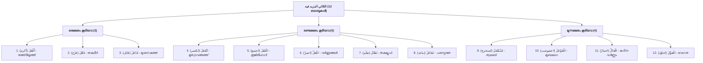

# الثُّلَاثِيُّ الْمَزِيدُ فِيهِ وَدَلَالَاتُ أَوْزَانِ الزِّيَادَةِ
## മസീദായ മൂന്നക്ഷര ക്രിയകളും അധികാക്ഷരങ്ങളുടെ അർത്ഥങ്ങളും — Augmented Triliteral Verbs: Morphological Affixes & Semantic Shifts

<!-- Top Navigation Bar -->
[⬅️ മുൻ അധ്യായം: 03. أبواب الثلاثي المجرد](file:///Users/apple/Desktop/docs/Kanz-al-Tahqiq/Kanz-al-Tahqiq-pub/Texts/Sarf/zanjan/Notes/Chapters/03-abwab-al-thulathi-al-mujarrad.md) | [📑 സൂചിക / Master Index](file:///Users/apple/Desktop/docs/Kanz-al-Tahqiq/Kanz-al-Tahqiq-pub/Texts/Sarf/zanjan/Notes/Chapters/00-index.md) | [അടുത്ത അധ്യായം: 05. الرباعي المجرد والمزيد ⏭️](file:///Users/apple/Desktop/docs/Kanz-al-Tahqiq/Kanz-al-Tahqiq-pub/Texts/Sarf/zanjan/Notes/Chapters/05-al-rubai-al-mujarrad-wal-mulhaq.md)

---

### 1. മൂലപാഠം / النص الأصلي (Al-Matn al-Aṣl)

وَأَمَّا **الثُّلَاثِيُّ الْمَزِيدُ فِيهِ**: فَيَنْقَسِمُ بِحَسَبِ حُرُوفِ الزِّيَادَةِ إِلَى ثَلَاثَةِ أَقْسَامٍ:

### أَوَّلاً: مَا زِيدَ فِيهِ حَرْفٌ وَاحِدٌ (ثَلَاثَةُ أَبْوَابٍ):
1. **أَفْعَلَ يُفْعِلُ إِفْعَالاً**؛ نَحْوُ: **أَكْرَمَ يُكْرِمُ إِكْرَاماً** (وَأَصْلُهُ: كَرُمَ).
2. **فَعَّلَ يُفَعِّلُ تَفْعِيلاً**؛ نَحْوُ: **فَرَّحَ يُفَرِّحُ تَفْرِيحاً** (وَأَصْلُهُ: فَرِحَ).
3. **فَاعَلَ يُفَاعِلُ مُفَاعَلَةً وَفِعَالاً**؛ نَحْوُ: **قَاتَلَ يُقَاتِلُ مُقَاتَلَةً وَقِتَالاً** (وَأَصْلُهُ: قَتَلَ).

### ثَانِياً: مَا زِيدَ فِيهِ حَرْفَانِ (خَمْسَةُ أَبْوَابٍ):
1. **انْفَعَلَ يَنْفَعِلُ انْفِعَالاً**؛ نَحْوُ: **انْكَسَرَ يَنْكَسِرُ انْكِسَاراً** (لِلْمُطَاوَعَةِ).
2. **افْتَعَلَ يَفْتَعِلُ افْتِعَالاً**؛ نَحْوُ: **اجْتَمَعَ يَجْتَمِعُ اجْتِمَاعاً**.
3. **افْعَلَّ يَفْعَلُّ افْعِلَالاً**؛ نَحْوُ: **احْمَرَّ يَحْمَرُّ احْمِرَاراً** (لِلأَلْوَانِ وَالعُيُوبِ).
4. **تَفَعَّلَ يَتَفَعَّلُ تَفَعُّلاً**؛ نَحْوُ: **تَكَلَّمَ يَتَكَلَّمُ تَكَلُّماً**، وَتَعَلَّمَ يَتَعَلَّمُ تَعَلُّماً.
5. **تَفَاعَلَ يَتَفَاعَلُ تَفَاعُلاً**؛ نَحْوُ: **تَبَاعَدَ يَتَبَاعَدُ تَبَاعُداً**، وَتَضَارَبَ يَتَضَارَبُ تَضَارُباً.

### ثَالِثاً: مَا زِيدَ فِيهِ ثَلَاثَةُ أَحْرُفٍ (أَرْبَعَةُ أَبْوَابٍ):
1. **اسْتَفْعَلَ يَسْتَفْعِلُ اسْتِفْعَالاً**؛ نَحْوُ: **اسْتَخْرَجَ يَسْتَخْرِجُ اسْتِخْرَاجاً** (لِلطَّلَبِ).
2. **افْعَوْعَلَ يَفْعَوْعِلُ افْعِيعَالاً**؛ نَحْوُ: **اعْشَوْشَبَ يَعْشَوْشِبُ اعْشِيشَاباً** (لِلْمُبَالَغَةِ).
3. **افْعَالَّ يَفْعَالُّ افْعِيلَالاً**؛ نَحْوُ: **احْمَارَّ يَحْمَارُّ احْمِيرَاراً** (مُبَالَغَةُ احْمَرَّ).
4. **افْعَوَّلَ يَفْعَوِّلُ افْعِوَّالاً**؛ نَحْوُ: **اجْلَوَّذَ يَجْلَوِّذُ اجْلِوَّاذًا** (أَيْ أَسْرَعَ فِي السَّيْرِ).

---

### 2. മലയാള പരിഭാഷ (ദർസ് ശൈലിയിലുള്ള വാച്യാർത്ഥവും ആശയവും)

മൂലാക്ഷരങ്ങൾക്ക് പുറമെ അധികാക്ഷരങ്ങൾ (സവാഇദ്) ചേർത്ത മൂന്നക്ഷര ക്രിയകൾ (ഥുലാഥീ മസീദ് ഫീഹ്) മൂന്ന് വിഭാഗങ്ങളിലായി ആകെ **12 ബാബുകളാണ്**:

#### ഒന്നാം വിഭാഗം: ഒരൊറ്റ അക്ഷരം അധികരിച്ചവ (3 ബാബുകൾ)
1. **أَفْعَلَ - يُفْعِلُ - إِفْعَالاً (അഫ്അല):** തുടക്കത്തിൽ ഹംസ അധികരിച്ചത്; ഉദാ: **أَكْرَمَ يُكْرِمُ إِكْرَاماً** (അവൻ ആദരിച്ചു). പ്രധാനമായും കർമ്മമില്ലാത്ത ക്രിയയെ കർമ്മമുള്ളതാക്കാനാണ് (തഅ്ദിയ്യത്ത്) ഇത് വരുന്നത്.
2. **فَعَّلَ - يُفَعِّلُ - تَفْعِيلاً (ഫഅ്അല):** മധ്യത്തിലെ ഐനിനെ ഇരട്ടിപ്പിച്ചത് (തദ്‌ഈഫ്); ഉദാ: **فَرَّحَ يُفَرِّحُ تَفْرِيحاً** (അവൻ സന്തോഷിപ്പിച്ചു). കഠിനത, ആവർത്തനം (മുബാലഗഃ) എന്നിവക്കാണ് ഇത് വരുന്നത്.
3. **فَاعَلَ - يُفَاعِلُ - مُفَاعَلَةً (ഫാഅല):** ഫാഇനും ഐനിനുമിടയിൽ അലിഫ് അധികരിച്ചത്; ഉദാ: **قَاتَلَ يُقَاتِلُ مُقَاتَلَةً** (അവൻ പരസ്പരം പോരാടി). ഇരുവിഭാഗങ്ങൾ തമ്മിലുള്ള പങ്കാളിത്തത്തിന് (മുശാറകത്ത്) വരുന്നു.

#### രണ്ടാം വിഭാഗം: രണ്ട് അക്ഷരങ്ങൾ അധികരിച്ചവ (5 ബാബുകൾ)
1. **انْفَعَلَ (ഇൻഫഅല):** തുടക്കത്തിൽ ഹംസയും നൂനും അധികരിച്ചത്; ഉദാ: **انْكَسَرَ** (അത് പൊട്ടി). ഒരു പ്രവർത്തിയുടെ സ്വാധീനഫലം സ്വയം സ്വീകരിക്കുന്നതിനാണ് (മുത്വാവഅത്ത്) ഇത് വരുന്നു. ഇത് എപ്പോഴും ലാസിം (കർമ്മമില്ലാത്തത്) മാത്രമായിരിക്കും.
2. **افْتَعَلَ (ഇഫ്തഅല):** ഹംസയും താഉം അധികരിച്ചത്; ഉദാ: **اجْتَمَعَ** (അവർ ഒരുമിച്ചുകൂടി). പ്രയത്നത്തിനും സ്വയം ചെയ്യലിനും വരുന്നു.
3. **افْعَلَّ (ഇഫ്അല്ല):** തുടക്കത്തിൽ ഹംസയും ഒടുവിൽ ലാം ഇരട്ടിപ്പും; ഉദാ: **احْمَرَّ** (അവൻ കടുംചുവപ്പായി). നിറങ്ങളെയും ശാരീരിക വൈകല്യങ്ങളെയും കുറിക്കാൻ വരുന്നു.
4. **تَفَعَّلَ (തഫഅ്അല):** തുടക്കത്തിൽ താഉം മധ്യത്തിൽ ഇരട്ടിപ്പും; ഉദാ: **تَعَلَّمَ** (അവൻ പഠിച്ചു). ക്രമാനുഗതമായി ഒന്നിൽ എത്തിച്ചേരലിന് (തകല്ലുഫ്) വരുന്നു.
5. **تَفَاعَلَ (തഫാഅല):** താഉം അലിഫും അധികരിച്ചത്; ഉദാ: **تَبَاعَدَ** (അവർ പരസ്പരം അകന്നു). രണ്ടുപേർ ചേർന്നുള്ള പരസ്പര പ്രവർത്തിക്കാണ് ഇത് വരുന്നത്.

#### മൂന്നാം വിഭാഗം: മൂന്ന് അക്ഷരങ്ങൾ അധികരിച്ചവ (4 ബാബുകൾ)
1. **اسْتَفْعَلَ (ഇസ്തഫ്അല):** തുടക്കത്തിൽ ഹംസ, സീൻ, താഅ് (അലിഫ്-സീൻ-താഅ്) അധികരിച്ചത്; ഉദാ: **اسْتَخْرَجَ** (അവൻ പുറത്തെടുക്കാൻ ആവശ്യപ്പെട്ടു/ശ്രമിച്ചു). പ്രധാനമായും ഒരുകാര്യം ആവശ്യപ്പെടുന്നതിന് (ത്വലബ്) വരുന്നു.
2. **افْعَوْعَلَ (ഇഫ്ഔഅല):** ഹംസ, വാവ്, ഐൻ ഇരട്ടിപ്പ്; ഉദാ: **اعْشَوْشَبَ** (ഭൂമി നിറയെ പുല്ലുപിടിച്ചു - അതിശയോക്തി).
3. **افْعَالَّ (ഇഫ്ആല്ല):** ഹംസ, അലിഫ്, ലാം ഇരട്ടിപ്പ്; ഉദാ: **احْمَارَّ** (അതികഠിനമായി ചുവന്നു - احمر നേക്കാൾ മുബാലഗഃ).
4. **افْعَوَّلَ (ഇഫ്അവ്വല):** ഹംസ, ഇരട്ടിച്ച വാവ്; ഉദാ: **اجْلَوَّذَ** (വളരെ വേഗത്തിൽ ഒട്ടകം സഞ്ചരിച്ചു).

---

### 3. ഇംഗ്ലീഷ് വിവർത്തനം / English Scholastic Translation

The augmented triliteral verb (*al-Thulāthī al-Mazīd fīh*) expands the base tri-consonantal root by one, two, or three affixes across twelve canonical patterns (*Abwāb*), producing systematic semantic modulations:

#### Group I: Single-Letter Augmentation (3 Patterns)
1. ***Afʿala - Yufʿilu - Ifʿāl*:** Initial glottal prefix; e.g., *Akrama - Yukrimu - Ikrām* (to honor). Primary function: Causativity / Transitivity (*al-Taʿdiyah*).
2. ***Faʿʿala - Yufʿilu - Tafʿīl*:** Medial radical gemination; e.g., *Farraḥa - Yufarriḥu - Tafrīḥ* (to gladden). Primary function: Intensification / Multiplicity (*al-Takthīr*).
3. ***Fāʿala - Yufāʿilu - Mufāʿalah / Fiʿāl*:** Post-initial long vowel infix; e.g., *Qātala - Yuqātilu - Muqātalah / Qitāl* (to battle). Primary function: Reciprocity (*al-Mushārakah*).

#### Group II: Two-Letter Augmentations (5 Patterns)
1. ***Infaʿala - Yanfaʿilu - Infiʿāl*:** Prefix *In-*; e.g., *Inkasara - Yankasiru - Inkisār* (to break/shatter). Primary function: Passive reflexivity (*al-Muṭāwaʿah*). Strictly intransitive.
2. ***Iftaʿala - Yaftaʿilu - Iftiʿāl*:** Infix *-ta-*; e.g., *Ijtamaʿa - Yajtamiʿu - Ijtimāʿ* (to assemble). Primary function: Personal effort / Middle voice (*al-Iktisāb*).
3. ***Ifʿalla - Yafʿallu - Ifʿilāl*:** Final gemination; e.g., *Iḥmarra - Yaḥmarru - Iḥmirār* (to turn red). Primary function: Chromatic and bodily states (*al-Alwān wal-ʿUyūb*).
4. ***Tafaʿʿala - Yatafaʿʿalu - Tafaʿʿul*:** Prefix *Ta-* and medial gemination; e.g., *Taʿallama - Yataʿallamu - Taʿallum* (to learn). Primary function: Gradual acquisition (*al-Takalluf*).
5. ***Tafāʿala - Yatafāʿalu - Tafāʿul*:** Prefix *Ta-* and long vowel; e.g., *Tabāʿada - Yatabāʿadu - Tabāʿud* (to mutually distance). Primary function: Mutual engagement or pretense (*al-Takhāyul*).

#### Group III: Three-Letter Augmentations (4 Patterns)
1. ***Istafʿala - Yastafʿilu - Istifʿāl*:** Prefix *Ista-*; e.g., *Istakhraja - Yastakhriju - Istikhrāj* (to extract/solicit). Primary function: Requesting or deeming (*al-Ṭalab wal-Iʿtiqād*).
2. ***Ifʿawʿala - Yafʿawʿilu - Ifʿīʿāl*:** Infix *Wāw* and repeated *ʿAyn*; e.g., *Iʿshawshaba - Yaʿshawshibu* (to flourish with abundant grass). Primary function: Hyperbole (*al-Mubālaghah*).
3. ***Ifʿālla - Yafʿāllu - Ifʿīlāl*:** Infix *Alif* and gemination; e.g., *Iḥmārra - Yaḥmārru* (to turn intensely crimson).
4. ***Ifʿawwala - Yafʿawwilu - Ifʿiwwāl*:** Doubled *Wāw*; e.g., *Ijlawwadha - Yajlawwidhu* (to gallop at high velocity).

---

### 4. ത്രിഭാഷാ പദസൂചിക / المصطلحات / Key Terminology Matrix

| അറബിക് പദം (Arabic) | ലിപ്യന്തരണം (Transliteration) | മലയാള അർത്ഥം (Malayalam Equivalent) | English Logic/Grammar Term | സാങ്കേതിക വിവരണം (Scholastic Definition) |
|---|---|---|---|---|
| **المَزِيد فِيه** | *al-mazīd fīh* | അധികാക്ഷരങ്ങൾ ഉള്ളത് | Augmented Verb Form | മൂലാക്ഷരങ്ങൾക്ക് പുറമെ ഒന്നു മുതൽ മൂന്ന് വരെ അക്ഷരങ്ങൾ കൂട്ടിച്ചേർത്തത്. |
| **التَّعْدِيَة** | *al-taʿdiyah* | കർമ്മമുള്ളതാക്കൽ | Causativization / Transitivity | കർമ്മമില്ലാത്ത ലാസിമായ ക്രിയയെ കർമ്മമുള്ള മുത്തഅദ്ദിയാക്കി മാറ്റൽ. |
| **المُطَاوَعَة** | *al-muṭāwaʿah* | അനന്തരഫലം സ്വീകരിക്കൽ | Reflexivity / Middle Voice | ഒരു ക്രിയയുടെ കർമ്മം ആ ക്രിയയുടെ ബാഹ്യസ്വാധീനം സ്വയം സ്വീകരിക്കുന്നത് (ഉദാ: കസറഹു ഫൻകസറ). |
| **المُشَارَكَة** | *al-mushārakah* | പരസ്പര പങ്കാളിത്തം | Reciprocity | രണ്ട് വ്യക്തികൾ പരസ്പരം ഒരേ പ്രവർത്തിയിൽ ഏർപ്പെടുന്നത് (ഉദാ: ഖാതല). |
| **التَّكَلُّف** | *al-takalluf* | പ്രയത്നിച്ചുള്ള ആർജ്ജനം | Gradual Endeavor / Pretense | പ്രയാസപ്പെട്ട് ഘട്ടംഘട്ടമായി ഒരു കാര്യം സ്വായത്തമാക്കൽ (ഉദാ: തഅല്ലമ). |
| **الطَّلَب** | *al-ṭalab* | ആവശ്യപ്പെടൽ | Petitive / Requestative | ഒരു കാര്യത്തെ ആവശ്യപ്പെടുന്ന അർത്ഥം നൽകൽ (ഇസ്തഗ്ഫറ = പാപമോചനം തേടി). |

---

### 5. വിശദമായ ശർഹും തത്വവിചാരവും / الشرح والتحليل المعمق

#### എ. "പദഘടനയിലെ വർദ്ധനവ് അർത്ഥത്തിലെ വർദ്ധനവിനെ കുറിക്കുന്നു" (زيادة المبنى تدل على زيادة المعنى):
അറബിക് സ്വറഫ് ശാസ്ത്രത്തിലെ സുവർണ്ണ നിയമമാണിത്:
- **«حَمِرَ»** (ഹമിറ - ഥുലാഥീ മുജർറദ്): സാധാരണ ചുവപ്പായി.
- **«احْمَرَّ»** (ഇഹ്മർറ - രണ്ട് അക്ഷരം അധികരിച്ചത്): കൂടുതൽ ചുവപ്പായി.
- **«احْمَارَّ»** (ഇഹ്മാറ്‌റ - മൂന്ന് അക്ഷരം അധികരിച്ചത്): അതികഠിനമായി കടുംചുവപ്പായി.  
അക്ഷരങ്ങൾ കൂടുന്തോറും ആ പദം ഉൾക്കൊള്ളുന്ന ഭാവതീവ്രതയും അർത്ഥവ്യാപ്തിയും വർദ്ധിക്കുന്നു.

#### ബി. അധികാക്ഷരങ്ങളുടെ രഹസ്യക്കൂട്ടം (Letters of Augmentation):
അറബിയിൽ മൂലാക്ഷരങ്ങളിലേക്ക് അധികരിക്കാൻ സാധിക്കുന്ന അക്ഷരങ്ങൾ 10 എണ്ണമാണ്. പണ്ഡിതന്മാർ അതിനെ **«سَأَلْتُمُونِيهَا» (സഅൽത്തുമൂനീഹാ)** അഥവാ **«اليَوْمَ تَنْسَاهُ»** എന്ന വാക്യത്തിൽ ക്രോഡീകരിച്ചിരിക്കുന്നു:
(സ, അ, ല, ത, മ, വ, ന, യ, ഹ, അലിഫ്). ഇവയല്ലാത്ത മറ്റൊരു അക്ഷരവും അറബിയിൽ മൂലാക്ഷരങ്ങളിലേക്ക് അധികരിക്കപ്പെടുകയില്ല (തദ്‌ഈഫ് ഒഴികെ).

---

### 6. ചിത്രരൂപങ്ങളും താരതമ്യ പട്ടികകളും / Visual Diagrams & Matrices

---

### 7. ഉദാഹരണ വിശകലനം / Analysis of Classical Quranic & Hadith Examples

- **«അഫ്അല» യുടെ തഅ്ദിയ്യത്ത്:**  
  ﴿كِتَابٌ أَنزَلْنَاهُ إِلَيْكَ لِتُخْرِجَ النَّاسَ مِنَ الظُّلُمَاتِ إِلَى النُّورِ﴾ [[سورة إبراهيم: 1](https://quran.com/14/1)]  
  «أَنْزَلَ» (നസല എന്നതിൽ നിന്ന് അഫ്അല വഴി ഇറക്കി എന്ന് കർമ്മമുള്ളതാക്കി). «تُخْرِجَ» (ഖറജ എന്നതിൽ നിന്ന് പുറത്താക്കുക എന്ന് കർമ്മമുള്ളതാക്കി).
- **«ഇസ്തഫ്അല» യുടെ ത്വലബ് (തേടൽ):**  
  ﴿فَاسْتَغْفِرُوهُ ثُمَّ تُوبُوا إِلَيْهِ﴾ [[سورة هود: 61](https://quran.com/11/61)]  
  «اسْتَغْفَرَ» = ഗഫറ (പൊറുത്തു) എന്നതിൽ നിന്ന് 'പാപമോചനം തേടി' എന്ന അർത്ഥത്തിലേക്ക് മാറ്റി.

---

### 8. ശ്രദ്ധിക്കേണ്ട സൂക്ഷ്മതകൾ / تنبيهات ومزالق شائعة (Common Student Pitfalls)

> [!CAUTION]
> **«انْفَعَلَ» (ഇൻഫഅല ബാബ്) ഒരിക്കലും മുത്തഅദ്ദിയാവില്ല!**  
> ഒരു ബാഹ്യ പ്രവർത്തിയുടെ അനന്തരഫലം സ്വയം ഏൽക്കുന്നതിനായാണ് (മുത്വാവഅത്ത്) ഇൻഫഅല വരുന്നത് (ഉദാ: «كَسَرْتُ الزُّجَاجَ فَانْكَسَرَ» - ഞാൻ ചില്ല് പൊട്ടിച്ചു, അപ്പോൾ അത് സ്വയം പൊട്ടിപ്പോയി). അതിനാൽ ഇൻഫഅല ബാബിലെ ക്രിയകൾക്ക് ഒരിക്കലും ഒരു 'മഫ്ഊൽ ബിഹി' (കർമ്മം) ഉണ്ടാവുകയില്ല; അത് സദാ ലാസിം മാത്രമായിരിക്കും!

---

### 9. ആവർത്തന ചോദ്യങ്ങളും വ്യായാമങ്ങളും / تدريبات وتمارين (Review Exercises)

1. മൂന്നക്ഷര മസീദായ ക്രിയകൾ ആകെ എത്ര ബാബുകളാണ്? അവയെ എങ്ങനെയെല്ലാമാണ് തരംതിരിച്ചിരിക്കുന്നത്?
2. «أَكْرَمَ»، «قَاتَلَ»، «انْكَسَرَ»، «اسْتَغْفَرَ» എന്നീ ക്രിയകളിലെ അധികാക്ഷരങ്ങളും അവ നൽകുന്ന പുതിയ അർത്ഥങ്ങളും വ്യക്തമാക്കുക.
3. «സഅൽത്തുമൂനീഹാ» (سألتمونيها) എന്ന പദം സ്വറഫ് ശാസ്ത്രത്തിൽ എന്തിനെയാണ് കുറിക്കുന്നത്?
4. «احْمَرَّ» എന്നതിനേക്കാൾ തീവ്രത «احْمَارَّ» എന്നതിന് ഉണ്ടാകാനുള്ള സ്വറഫിലെ അടിസ്ഥാന തത്വം എന്ത്?
