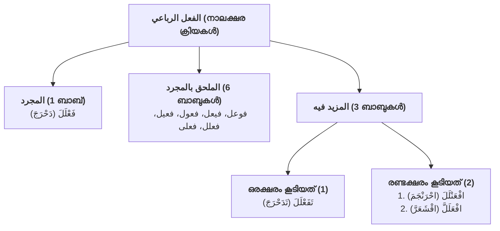

# الرُّبَاعِيُّ الْمُجَرَّدُ وَالْمَزِيدُ فِيهِ وَمُلْحَقَاتُهُ
## നാലക്ഷര ക്രിയകളും അവയോട് സാദൃശ്യപ്പെടുത്തിയവയും — Quadriliteral Verbs: Bare Root, Augmented Forms & Morphological Annexes (Mulḥaqāt)

<!-- Top Navigation Bar -->
[⬅️ മുൻ അധ്യായം: 04. الثلاثي المزيد فيه](file:///Users/apple/Desktop/docs/Kanz-al-Tahqiq/Kanz-al-Tahqiq-pub/Texts/Sarf/zanjan/Notes/Chapters/04-al-thulathi-al-mazid-fih.md) | [📑 സൂചിക / Master Index](file:///Users/apple/Desktop/docs/Kanz-al-Tahqiq/Kanz-al-Tahqiq-pub/Texts/Sarf/zanjan/Notes/Chapters/00-index.md) | [അടുത്ത അധ്യായം: 06. المتعدي واللازم ⏭️](file:///Users/apple/Desktop/docs/Kanz-al-Tahqiq/Kanz-al-Tahqiq-pub/Texts/Sarf/zanjan/Notes/Chapters/06-al-mutaaddi-wal-lazim.md)

---

### 1. മൂലപാഠം / النص الأصلي (Al-Matn al-Aṣl)

### أَوَّلاً: الرُّبَاعِيُّ الْمُجَرَّدُ:
بَابٌ وَاحِدٌ، وَهُوَ: **فَعْلَلَ يُفَعْلِلُ فَعْلَلَةً وَفِعْلَالاً**؛ نَحْوُ: **دَحْرَجَ يُدَحْرِجُ دَحْرَجَةً وَدِحْرَاجاً**، وَزَلْزَلَ يُزَلْزِلُ زَلْزَلَةً وَزِلْزَالاً.

### ثَانِياً: المُلْحَقُ بِالرُّبَاعِيِّ الْمُجَرَّدِ (سِتَّةُ أَبْوَابٍ):
وَضَابِطُ الإِلْحَاقِ: أَنْ تَزِيدَ فِي الثُّلَاثِيِّ حَرْفاً لِيُوَازِنَ الرُّبَاعِيَّ فِي حَرَكَاتِهِ وَسَكَنَاتِهِ، وَيَجْرِيَ فِي تَصْرِيفِهِ مَجْرَاهُ:
1. **فَوْعَلَ يُفَوْعِلُ فَوْعَلَةً**؛ نَحْوُ: **حَوْقَلَ يُحَوْقِلُ حَوْقَلَةً** (أَيْ قَالَ: لَا حَوْلَ وَلَا قُوَّةَ إِلَّا بِاللَّهِ).
2. **فَيْعَلَ يُفَيْعِلُ فَيْعَلَةً**؛ نَحْوُ: **بَيْطَرَ يُبَيْطِرُ بَيْطَرَةً** (أَيْ عَالَجَ الدَّوَابَّ).
3. **فَعْوَلَ يُفَعْوِلُ فَعْوَلَةً**؛ نَحْوُ: **جَهْوَرَ يُجَهْوِرُ جَهْوَرَةً** (أَيْ رَفَعَ صَوْتَهُ).
4. **فَعْيَلَ يُفَعْيِلُ فَعْيَلَةً**؛ نَحْوُ: **عَثْيَرَ يُعَثْيِرُ عَثْيَرَةً**.
5. **فَعْلَلَ يُفَعْلِلُ فَعْلَلَةً**؛ نَحْوُ: **جَلْبَبَ يُجَلْبِبُ جَلْبَبَةً** (أَيْ أَلْبَسَهُ الجِلْبَابَ).
6. **فَعْلَى يُفَعْلِي فَعْلَيَةً**؛ نَحْوُ: **سَلْقَى يُسَلْقِي سَلْقَيَةً** (أَيْ أَلْقَاهُ عَلَى ظَهْرِهِ).

### ثَالِثاً: الرُّبَاعِيُّ الْمَزِيدُ فِيهِ:
وَهُوَ عَلَى قِسْمَيْنِ:
- **مَزِيدٌ بِحَرْفٍ وَاحِدٍ (بَابٌ وَاحِدٌ):** **تَفَعْلَلَ يَتَفَعْلَلُ تَفَعْلُلاً**؛ نَحْوُ: **تَدَحْرَجَ يَتَدَحْرَجُ تَدَحْرُجاً** (لِلْمُطَاوَعَةِ).
- **مَزِيدٌ بِحَرْفَيْنِ (بَابَانِ):**
  1. **افْعَنْلَلَ يَفْعَنْلِلُ افْعِنْلَالاً**؛ نَحْوُ: **احْرَنْجَمَ يَحْرَنْجِمُ احْرِنْجَاماً** (أَيِ اجْتَمَعَتِ الإِبِلُ).
  2. **افْعَلَلَّ يَفْعَلِلُّ افْعِلَّالاً**؛ نَحْوُ: **اقْشَعَرَّ يَقْشَعِرُّ اقْشِعْرَاراً**.

---

### 2. മലയാള പരിഭാഷ (ദർസ് ശൈലിയിലുള്ള വാച്യാർത്ഥവും ആശയവും)

നാല് മൂലാക്ഷരങ്ങളുള്ള ക്രിയകളെ (റുബാഈ) മൂന്ന് പ്രധാന വിഭാഗങ്ങളായി തിരിക്കാം:

#### 1. റുബാഈ മുജർറദ് (നാലക്ഷര മൂലാക്ഷര ക്രിയകൾ)
ഇതിന് ഒരൊറ്റ ബാബ് മാത്രമേയുള്ളൂ:
- **فَعْلَلَ - يُفَعْلِلُ - فَعْلَلَةً وَفِعْلَالاً (ഫഅ്‌ലല - യുഫഅ്‌ലിലു):** ഉദാഹരണം: **دَحْرَجَ يُدَحْرِجُ دَحْرَجَةً وَدِحْرَاجاً** (അവൻ ഉരുട്ടി), **زَلْزَلَ يُزَلْزِلُ زَلْزَلَةً وَزِلْزَالاً** (അവൻ പിടിച്ചുകുലുക്കി).

#### 2. മുൽഹഖ് ബിർറുബാഈ (നാലക്ഷര ക്രിയയോട് സാദൃശ്യപ്പെടുത്തിയവ)
ഒരു മൂന്നക്ഷര ക്രിയയിലേക്ക് ഒരു അധികാക്ഷരം ചേർത്ത്, അതിനെ റുബാഈ ക്രിയയുടെ ചലന-നിശ്ചലതകളോട് (ഹറകത്തുകളും സകനത്തുകളും) തുല്യമാക്കുകയും, അതിന്റെ അതേ മസ്ദറും വിഭക്തികളും സ്വീകരിക്കുകയും ചെയ്യുന്നതിനാണ് **«ഇൽഹാഖ്» (الإلحاق)** എന്ന് പറയുന്നത്. ഇതിന് ആറ് ബാബുകളുണ്ട്:
1. **فَوْعَلَ (ഫൗഅല):** ഫാഇനും ഐനിനുമിടയിൽ വാവ് അധികരിച്ചത്; ഉദാ: **حَوْقَلَ** (ഹൗഖല - 'ലാ ഹൗല വലാ ഖുവ്വത്ത ഇല്ലാ ബില്ലാഹ്' എന്ന് ചൊല്ലി).
2. **فَيْعَلَ (ഫൈഅല):** ഫാഇനും ഐനിനുമിടയിൽ യാഅ് അധികരിച്ചത്; ഉദാ: **بَيْطَرَ** (ബൈത്വറ - മൃഗചികിത്സ നടത്തി).
3. **فَعْوَلَ (ഫഅ്‌വല):** ഐനിനും ലാമിനുമിടയിൽ വാവ് അധികരിച്ചത്; ഉദാ: **جَهْوَرَ** (ജഹ്‌വറ - ശബ്ദം ഉയർത്തി).
4. **فَعْيَلَ (ഫഅ്‌യല):** ഐനിനും ലാമിനുമിടയിൽ യാഅ് അധികരിച്ചത്; ഉദാ: **عَثْيَرَ** (അഥ്‌യറ).
5. **فَعْلَلَ (ഫഅ്‌ലല):** ഒടുവിലെ ലാമിനെ ഇരട്ടിപ്പിച്ചത്; ഉദാ: **جَلْبَبَ** (ജൽബബ - ജിൽബാബ് ധരിപ്പിച്ചു).
6. **فَعْلَى (ഫഅ്‌ലാ):** ഒടുവിൽ അലിഫ് മഖ്സൂറഃ ചേർത്തത്; ഉദാ: **سَلْقَى** (സൽഖാ - മലർത്തിയടിച്ചു).

#### 3. റുബാഈ മസീദ് ഫീഹ് (നാലക്ഷരത്തിൽ അധികാക്ഷരം ചേർത്തവ)
ഇത് രണ്ട് വിധമാണ്:
- **ഒരൊറ്റ അക്ഷരം കൂടിയത് (1 ബാബ്):** **تَفَعْلَلَ يَتَفَعْلَلُ تَفَعْلُلاً**; ഉദാ: **تَدَحْرَجَ** (തദഹ്‌റജ - അത് ഉരുണ്ടുപോയി; ദഹ്‌റജയുടെ മുത്വാവഅത്ത്).
- **രണ്ട് അക്ഷരങ്ങൾ കൂടിയത് (2 ബാബുകൾ):**
  1. **افْعَنْلَلَ (ഇഫ്അൻലല):** ഹംസയും നൂനും അധികരിച്ചത്; ഉദാ: **احْرَنْجَمَ** (ഇഹ്‌റൻജമ - ഒട്ടകങ്ങൾ തിങ്ങിക്കൂടി).
  2. **افْعَلَلَّ (ഇഫ്അലല്ല):** ഹംസയും ലാം ഇരട്ടിപ്പും അധികരിച്ചത്; ഉദാ: **اقْشَعَرَّ** (ഇഖ്ശഅർറ - രോമാഞ്ചമുണ്ടായി).

---

### 3. ഇംഗ്ലീഷ് വിവർത്തനം / English Scholastic Translation

Quadriliteral verbs (*al-Rubāʿī*) encompass roots consisting of four primary consonants, alongside derived patterns structurally coordinated (*Mulḥaq*) with them:

#### I. Bare Quadriliteral (*al-Rubāʿī al-Mujarrad*)
Possesses exclusively one canonical door:
- ***Faʿlala - Yufaʿlilu - Faʿlalah / Fiʿlāl*:** e.g., *Daḥraja - Yudaḥriju - Daḥrajatan wa Diḥrājā* (to roll down), *Zalzala - Yuzalzilu - Zalzalatan wa Zilzālā* (to shake violently).

#### II. Coordinated Quadriliteral Stems (*al-Mulḥaq bi-al-Rubāʿī*)
Morphological coordination (*al-Ilḥāq*) occurs when an augment is affixed to a triliteral root to match the consonantal quantity, vowel placements, and quiescences (*Ḥarakāt wa Sakanāt*) of the quadriliteral paradigm, taking identical verbal noun endings. There are six canonical patterns:
1. ***Fawʿala*:** Infix *-w-*; e.g., *Ḥawqala* (to recite the Hawqalah).
2. ***Fayʿala*:** Infix *-y-*; e.g., *Bayṭara* (to treat beasts/veterinary practice).
3. ***Faʿwala*:** Post-medial *-w-*; e.g., *Jahwara* (to raise the voice).
4. ***Faʿyala*:** Post-medial *-y-*; e.g., *ʿAthyara* (to stumble).
5. ***Faʿlala*:** Geminated second *Lām*; e.g., *Jalbaba* (to clothe with a jilbāb).
6. ***Faʿlā*:** Terminal defective *Alif*; e.g., *Salqā* (to throw someone on their back).

#### III. Augmented Quadriliteral (*al-Rubāʿī al-Mazīd fīh*)
Comprises three patterns across two structural tiers:
- **Single-Letter Augment (1 Door):** ***Tafaʿlala - Yatafaʿlalu - Tafaʿlul*:** e.g., *Tadaḥraja* (to roll autonomously, reflexive/mutāwa'ah of *daḥraja*).
- **Two-Letter Augments (2 Doors):**
  1. ***Ifʿanlala - Yafʿanlilu - Ifʿinlāl*:** Prefixed *Hamzah* and infixed *Nūn*; e.g., *Iḥranjama* (of camels: to crowd together).
  2. ***Ifʿalalla - Yafʿalillu - Ifʿillāl*:** Prefixed *Hamzah* and geminated final radical; e.g., *Iqshaʿarra* (of skin: to shudder/quiver with goosebumps).

---

### 4. ത്രിഭാഷാ പദസൂചിക / المصطلحات / Key Terminology Matrix

| അറബിക് പദം (Arabic) | ലിപ്യന്തരണം (Transliteration) | മലയാള അർത്ഥം (Malayalam Equivalent) | English Logic/Grammar Term | സാങ്കേതിക വിവരണം (Scholastic Definition) |
|---|---|---|---|---|
| **الرُّبَاعِيُّ المُجَرَّد** | *al-rubāʿī al-mujarrad* | നാലക്ഷര മൂലാക്ഷര ക്രിയ | Bare Quadriliteral Verb | നാല് മൂലാക്ഷരങ്ങൾ അടങ്ങിയ ക്രിയ (ഫഅ്‌ലല - ദഹ്‌റജ). |
| **الإِلْحَاق** | *al-ilḥāq* | സാദൃശ്യപ്പെടുത്തൽ | Morphological Coordination | മൂന്നക്ഷര ക്രിയയെ അക്ഷരങ്ങളുടെ ചലനത്തിൽ നാലക്ഷര ക്രിയയോട് തുല്യമാക്കൽ. |
| **المُلْحَق** | *al-mulḥaq* | തുല്യമാക്കപ്പെട്ട പദം | Coordinated Derivative | റുബാഈയുടെ സമാന തൂക്കത്തിൽ വരുന്ന മൂന്നക്ഷര ക്രിയ (ഉദാ: ഹൗഖല, ബൈത്വറ). |
| **النَّحْت** | *al-naḥt* | വാക്യച്ചുരുക്ക നാമകരണം | Acronymic Compounding | ഒരു വാക്യത്തിലെ പ്രധാന അക്ഷരങ്ങൾ എടുത്ത് ഒരു പുതിയ ക്രിയ ഉണ്ടാക്കൽ (ഹൗഖല, ബസ്മല). |

---

### 5. വിശദമായ ശർഹും തത്വവിചാരവും / الشرح والتحليل المعمق

#### എ. എന്താണ് ഇൽഹാഖ് (الإلحاق)?
അറബി ഭാഷയിലെ അതീവ കൗതുകകരമായ ഒരു പ്രതിഭാസമാണിത്. «حَوْقَلَ» (ഹൗഖല) എന്ന പദം പരിശോധിക്കുക:
- ഇതിന്റെ മൂലാക്ഷരങ്ങൾ «ح - ق - ل» (ഹഖല) ആണ്.
- ഇതിലേക്ക് 'വാവ്' അധികരിച്ചു.
- എന്തുകൊണ്ട് ഇതിനെ ഥുലാഥീ മസീദിൽ എണ്ണിയില്ല?  
കാരണം, ഇതിന്റെ ചലനവും നിശ്ചലതയും (حَرَكَة - سُكُون - حَرَكَة - حَرَكَة) കൃത്യമായി «دَحْرَجَ» (ദഹ്‌റജ) എന്ന റുബാഈ മുജർറദിന് തുല്യമാണ്. മാത്രമല്ല, ദഹ്‌റജയുടെ അതേ മസ്ദറായ «فَعْلَلَة» (ദഹ്‌റജത്തൻ) എന്നതുപോലെ തന്നെയാണ് «حَوْقَلَة» (ഹൗഖലത്തൻ) എന്നും വരുന്നത്. അതിനാൽ ഇതിനെ **«മുൽഹഖ് ബിർറുബാഈ» (റുബാഈയോട് ചേർത്തപ്പെട്ടത്)** എന്ന് വിളിക്കുന്നു.

#### ബി. നഹ്ത് (النحت - Acronymic Verbs):
റുബാഈ ബാബിൽ അറബികൾ സാങ്കേതിക വാക്യങ്ങളെ ഒരൊറ്റ ക്രിയയായി ചുരുക്കി പ്രയോഗിക്കാറുണ്ട്:
- **بَسْمَلَ** (ബസ്മല) = بِسْمِ اللَّهِ الرَّحْمَنِ الرَّحِيمِ എന്ന് പറഞ്ഞു.
- **حَمْدَلَ** (ഹംദല) = الحَمْدُ لِلَّهِ എന്ന് പറഞ്ഞു.
- **حَوْقَلَ** (ഹൗഖല) = لَا حَوْلَ وَلَا قُوَّةَ إِلَّا بِاللَّهِ എന്ന് പറഞ്ഞു.
- **حَسْبَلَ** (ഹസ്ബല) = حَسْبُنَا اللَّهُ وَنِعْمَ الوَكِيلُ എന്ന് പറഞ്ഞു.

---

### 6. ചിത്രരൂപങ്ങളും താരതമ്യ പട്ടികകളും / Visual Diagrams & Matrices

---

### 7. ഉദാഹരണ വിശകലനം / Analysis of Classical Quranic & Hadith Examples

- **റുബാഈ മുജർറദിന്റെ ഖുർആൻ പ്രയോഗം:**  
  ﴿إِذَا زُلْزِلَتِ الْأَرْضُ زِلْزَالَهَا﴾ [[سورة الزلزلة: 1](https://quran.com/99/1)]  
  «زُلْزِلَتْ» - സൽസല എന്ന റുബാഈ മുജർറദിന്റെ മജ്ഹൂലായ രൂപം. «زِلْزَال» - ഫിഅ്‌ലാൽ എന്ന ക്രമത്തിലുള്ള റുബാഈ മസ്ദർ.
- **റുബാഈ മസീദിന്റെ (ഇഖ്ശഅർറ) ഖുർആൻ പ്രയോഗം:**  
  ﴿اللَّهُ نَزَّلَ أَحْسَنَ الْحَدِيثِ كِتَابًا مُّتَشَابِهًا مَّثَانِيَ تَقْشَعِرُّ مِنْهُ جُلُودُ الَّذِينَ يَخْشَوْنَ رَبَّهُمْ﴾ [[سورة الزمر: 23](https://quran.com/39/23)]  
  «تَقْشَعِرُّ» - 'ഇഖ്ശഅർറ' എന്ന രണ്ട് അക്ഷരം അധികരിച്ച റുബാഈ മസീദിന്റെ മുളാരിഅ് (ത്വവക്കീൽ / ഭയഭക്തിയാൽ തൊലി രോമാഞ്ചമണിയുന്നു).

---

### 8. ശ്രദ്ധിക്കേണ്ട സൂക്ഷ്മതകൾ / تنبيهات ومزالق شائعة (Common Student Pitfalls)

> [!NOTE]
> വിദ്യാർത്ഥികൾ «جَلْبَبَ» (ജൽബബ) എന്നതിനെ 'മുദാഅഫ്' ആണെന്ന് തെറ്റിദ്ധരിക്കാറുണ്ട്. ജൽബബയിൽ അവസാനത്തെ രണ്ട് അക്ഷരങ്ങൾ ഒന്നാണെങ്കിലും അത് ഇരട്ടിക്കലല്ല (ഇദ്ഗാം ഇല്ല), മറിച്ച് റുബാഈയോട് സാദൃശ്യപ്പെടുത്താനായി (ഇൽഹാഖിനായി) ബോധപൂർവ്വം രണ്ടാമതൊരു ലാം ചേർത്തതാണ്. അതിനാൽ ഇതിൽ ഇദ്ഗാം ചെയ്യൽ നിഷിദ്ധമാണ്!

---

### 9. ആവർത്തന ചോദ്യങ്ങളും വ്യായാമങ്ങളും / تدريبات وتمارين (Review Exercises)

1. റുബാഈ മുജർറദിന്റെ അധ്യായം ഏതാണ്? അതിന്റെ മസ്ദറുകൾ ഏതൊക്കെ?
2. സ്വറഫിലെ 'ഇൽഹാഖ്' എന്നാൽ എന്ത്? മുൽഹഖാത്തിന്റെ ആറ് ബാബുകൾ ഉദാഹരണ സഹിതം എഴുതുക.
3. «بَسْمَلَ»، «حَوْقَلَ» എന്നീ പദങ്ങൾ ഭാഷാപരമായി ഏത് ഗണത്തിൽ പെടുന്നു?
4. «تَدَحْرَجَ»، «احْرَنْجَمَ»، «اقْشَعَرَّ» എന്നിവയിലെ അധികാക്ഷരങ്ങൾ വേർതിരിച്ചു കാണിക്കുക.
