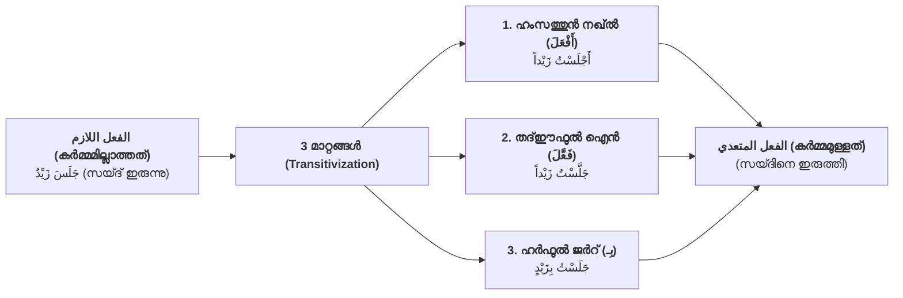

# الْمُتَعَدِّي وَاللَّازِمُ وَطُرُقُ تَحْوِيلِ الْأَفْعَالِ
## കർമ്മമുള്ളതും കർമ്മമില്ലാത്തതുമായ ക്രിയകളും തഅ്ദിയ്യത്തിന്റെ രീതികളും — Verbal Transitivity & Intransitivity: Syntactic Scope & Causative Shifts

<!-- Top Navigation Bar -->
[⬅️ മുൻ അധ്യായം: 05. الرباعي المجرد والمزيد](file:///Users/apple/Desktop/docs/Kanz-al-Tahqiq/Kanz-al-Tahqiq-pub/Texts/Sarf/zanjan/Notes/Chapters/05-al-rubai-al-mujarrad-wal-mulhaq.md) | [📑 സൂചിക / Master Index](file:///Users/apple/Desktop/docs/Kanz-al-Tahqiq/Kanz-al-Tahqiq-pub/Texts/Sarf/zanjan/Notes/Chapters/00-index.md) | [അടുത്ത അധ്യായം: 07. تصريف الفعل الماضي ⏭️](#)

---

### 1. മൂലപാഠം / النص الأصلي (Al-Matn al-Aṣl)

ثُمَّ الفِعْلُ يَنْقَسِمُ إِلَى **مُتَعَدٍّ** وَ**لَازِمٍ**:
- **الفِعْلُ الْمُتَعَدِّي** (وَيُسَمَّى وَاقِعاً وَمُجَاوِزاً): هُوَ الَّذِي يُجَاوِزُ فِعْلُ الفَاعِلِ إِلَى المَفْعُولِ بِهِ؛ كَقَوْلِكَ: «ضَرَبَ زَيْدٌ عَمْراً».  
  **وَعَلَامَتُهُ:** أَنْ يَصِحَّ أَنْ تَتَّصِلَ بِهِ هَاءُ الكِنَايَةِ الَّتِي تَعُودُ إِلَى غَيْرِ المَصْدَرِ؛ نَحْوُ: «زَيْدٌ ضَرَبْتُهُ».
- **الفِعْلُ اللَّازِمُ** (وَيُسَمَّى غَيْرَ وَاقِعٍ وَغَيْرَ مُجَاوِزٍ): هُوَ الَّذِي لَمْ يُجَاوِزْ فِعْلُ الفَاعِلِ إِلَى المَفْعُولِ بِهِ، بَلْ وَقَعَ فِي نَفْسِهِ؛ نَحْوُ: «قَعَدَ زَيْدٌ»، وَ«حَسُنَ عَمْرٌو».

### طُرُقُ تَحْوِيلِ اللَّازِمِ إِلَى مُتَعَدٍّ:
يُعَدَّى الفِعْلُ اللَّازِمُ إِلَى المَفْعُولِ بِهِ بِأَحَدِ ثَلَاثَةِ أُمُورٍ:
1. **بِهَمْزَةِ النَّقْلِ (أَفْعَلَ)**؛ نَحْوُ: «أَجْلَسْتُ زَيْداً» (مِنْ: جَلَسَ زَيْدٌ).
2. **بِتَضْعِيفِ العَيْنِ (فَعَّلَ)**؛ نَحْوُ: «فَرَّحْتُ عَمْراً» (مِنْ: فَرِحَ عَمْرٌو).
3. **بِحَرْفِ الجَرِّ**؛ نَحْوُ: «ذَهَبْتُ بِزَيْدٍ» (مِنْ: ذَهَبَ زَيْدٌ)، كَمَا فِي التَّنْزِيلِ العَزِيزِ: ﴿ذَهَبَ اللَّهُ بِنُورِهِمْ﴾ [[سورة البقرة: 17](https://quran.com/2/17)].

---

### 2. മലയാള പരിഭാഷ (ദർസ് ശൈലിയിലുള്ള വാച്യാർത്ഥവും ആശയവും)

അറബിക് ക്രിയകൾ വാക്യത്തിലെ കർമ്മവുമായുള്ള (മഫ്ഊൽ ബിഹി) ബന്ധത്തിന്റെ അടിസ്ഥാനത്തിൽ രണ്ട് പ്രധാന വിഭാഗങ്ങളായി തിരിയുന്നു:

#### 1. കർമ്മമുള്ള ക്രിയ (അൽ-മുത്തഅദ്ദി / വാഖിഅ് / മുജാവീസ്)
കർത്താവിന്റെ (ഫാഇൽ) പ്രവർത്തി കർത്താവിൽ മാത്രം ഒതുങ്ങിനിൽക്കാതെ ഒരു ബാഹ്യ കർമ്മത്തിലേക്ക് (മഫ്ഊൽ ബിഹി) കടന്നുചെല്ലുന്ന ക്രിയയാണിത്.  
- ഉദാഹരണം: **«ضَرَبَ زَيْدٌ عَمْراً»** (സയ്ദ് അംറിനെ അടിച്ചു). ഇവിടെ അടിക്കുക എന്ന പ്രവർത്തി സയ്ദിൽ നിന്ന് അംറിലേക്ക് സംക്രമിക്കുന്നു.
- **അടയാളം:** മസ്ദറിലേക്കല്ലാതെ വ്യക്തികളിലേക്ക് മടങ്ങുന്ന 'ഹാഉൽ കിനായഃ' (ളമീർ) ആ ക്രിയയോട് നേരിട്ട് ചേർത്തുവെക്കാൻ സാധിക്കണം; ഉദാ: «زَيْدٌ ضَرَبْتُهُ» (സയ്ദ്, അവനെ ഞാൻ അടിച്ചു).

#### 2. കർമ്മമില്ലാത്ത ക്രിയ (അൽ-ലാസിം / ഗൈറു വാഖിഅ് / ഗൈറു മുജാവീസ്)
കർത്താവിന്റെ പ്രവർത്തി കർത്താവിന്റെ ശരീരത്തിൽ മാത്രം ഒതുങ്ങിനിൽക്കുകയും പുറത്തുള്ള ഒരു കർമ്മത്തിലേക്ക് കടന്നുപോകാതിരിക്കുകയും ചെയ്യുന്ന ക്രിയ.  
- ഉദാഹരണം: **«قَعَدَ زَيْدٌ»** (സയ്ദ് ഇരുന്നു), **«حَسُنَ عَمْرٌو»** (അംറ് നല്ലവനായി).

#### ലാസിമായ ക്രിയയെ മുത്തഅദ്ദിയാക്കാനുള്ള 3 വഴികൾ:
കർമ്മമില്ലാത്ത ഒരു ക്രിയയെ കർമ്മമുള്ളതാക്കി മാറ്റാൻ മൂന്ന് മാർഗ്ഗങ്ങളുണ്ട്:
1. **ഹംസത്തുൻ നഖ്ൽ (തുടക്കത്തിൽ ഹംസ ചേർത്ത് «അഫ്അല» ആക്കുക):**  
   ഉദാഹരണം: «جَلَسَ زَيْدٌ» (സയ്ദ് ഇരുന്നു - ലാസിം) $\rightarrow$ **«أَجْلَسْتُ زَيْداً»** (ഞാൻ സയ്ദിനെ ഇരുത്തി - മുത്തഅദ്ദി).
2. **തദ്‌ഈഫുൽ ഐൻ (മധ്യത്തിലെ അക്ഷരത്തെ ഇരട്ടിപ്പിച്ച് «ഫഅ്അല» ആക്കുക):**  
   ഉദാഹരണം: «فَرِحَ عَمْرٌو» (അംറ് സന്തോഷിച്ചു - ലാസിം) $\rightarrow$ **«فَرَّحْتُ عَمْراً»** (ഞാൻ അംറിനെ സന്തോഷിപ്പിച്ചു - മുത്തഅദ്ദി).
3. **ഹർഫുൽ ജർറ് ചേർക്കുക:**  
   ഉദാഹരണം: «ذَهَبَ زَيْدٌ» (സയ്ദ് പോയി - ലാസിം) $\rightarrow$ **«ذَهَبْتُ بِزَيْدٍ»** (ഞാൻ സയ്ദിനെ കൊണ്ടുപോയി - മുത്തഅദ്ദി). വിശുദ്ധ ഖുർആനിലെ «ذَهَبَ اللَّهُ بِنُورِهِمْ» (അല്ലാഹു അവരുടെ പ്രകാശത്തെ നീക്കിക്കളഞ്ഞു) എന്നത് ഇതിന് ഉദാഹരണമാണ്.

---

### 3. ഇംഗ്ലീഷ് വിവർത്തനം / English Scholastic Translation

Verbs are comprehensively bifurcated by syntactic scope into **Transitive (*al-Mutaʿaddī*)** and **Intransitive (*al-Lāzim*)**:

#### I. The Transitive Verb (*al-Fiʿl al-Mutaʿaddī / al-Wāqiʿ / al-Mujāwiz*)
A verb whose semantic action extends beyond the agent (*al-Fāʿil*) to govern an objective accusative complement (*al-Mafʿūl bihi*); e.g., *Ḍaraba Zaydun ʿAmran* ("Zayd struck ʿAmr").  
*Diagnostic Criterion:* The capacity to directly affix the third-person objective pronoun suffix (*Hā' al-Kināyah*) referring to an entity other than the verbal noun; e.g., *Zaydun ḍarabtuhu* ("Zayd, I struck him").

#### II. The Intransitive Verb (*al-Fiʿl al-Lāzim / Ghayr al-Wāqiʿ / Ghayr al-Mujāwiz*)
A verb whose action remains confined within the subjectivity of the agent, without extending to an external object; e.g., *Qaʿada Zaydun* ("Zayd sat"), *Ḥasuna ʿAmrun* ("ʿAmr became handsome").

#### III. Three Mechanisms of Causative Transitivization:
An intransitive verb is systematically shifted into the transitive tier through one of three morpho-syntactic operators:
1. **The Causative Glottal Prefix (*Hamzat al-Naql* in Form IV *Afʿala*):** e.g., *Jalasa Zaydun* ("Zayd sat") $\rightarrow$ *Ajlastu Zaydan* ("I seated Zayd").
2. **Medial Radical Gemination (*Tadʿīf al-ʿAyn* in Form II *Faʿʿala*):** e.g., *Fariḥa ʿAmrun* ("ʿAmr was glad") $\rightarrow$ *Farraḥtu ʿAmran* ("I gladdened ʿAmr").
3. **Prepositional Transitivization (*Ḥarf al-Jarr*):** e.g., *Dhahaba Zaydun* ("Zayd went") $\rightarrow$ *Dhahabtu bi-Zaydin* ("I took Zayd away"), as in the Divine verse: *"Allah took away their light"* [[Surah al-Baqarah: 17](https://quran.com/2/17)].

---

### 4. ത്രിഭാഷാ പദസൂചിക / المصطلحات / Key Terminology Matrix

| അറബിക് പദം (Arabic) | ലിപ്യന്തരണം (Transliteration) | മലയാള അർത്ഥം (Malayalam Equivalent) | English Logic/Grammar Term | സാങ്കേതിക വിവരണം (Scholastic Definition) |
|---|---|---|---|---|
| **الفِعْلُ المُتَعَدِّي** | *al-fiʿl al-mutaʿaddī* | കർമ്മമുള്ള ക്രിയ | Transitive Verb | പ്രവർത്തനം മഫ്ഊൽ ബിഹിയിലേക്ക് കടന്നുചെല്ലുന്ന ക്രിയ. |
| **الفِعْلُ اللَّازِم** | *al-fiʿl al-lāzim* | കർമ്മമില്ലാത്ത ക്രിയ | Intransitive Verb | പ്രവർത്തനം ഫാഇലിൽ മാത്രം ഒതുങ്ങിനിൽക്കുന്ന ക്രിയ. |
| **هَمْزَةُ النَّقْل** | *hamzat al-naql* | സംക്രമണ ഹംസ | Causative Prefix Hamzah | ക്രിയയെ അടുത്ത ഘട്ടത്തിലേക്ക് സംക്രമിപ്പിക്കുന്ന 'അഫ്അല'യിലെ ഹംസ. |
| **هَاءُ الكِنَايَة** | *hā' al-kināyah* | വ്യക്തികളിലേക്ക് മടങ്ങുന്ന ഹാഅ് | Objective Pronominal Clitic | മഫ്ഊൽ ബിഹിയായി വരുന്ന സർവ്വനാമം (ളമീർ). |
| **البِنَاءُ لِلْمَفْعُول** | *al-binā' lil-mafʿūl* | മജ്ഹൂലാക്കൽ (കർമ്മണി പ്രയോഗം) | Passive Voice Construction | ഫാഇലിനെ നീക്കി മഫ്ഊലിനെ നായിബുൽ ഫാഇലാക്കി മാറ്റൽ. |

---

### 5. വിശദമായ ശർഹും തത്വവിചാരവും / الشرح والتحليل المعمق

#### എ. തഅ്ദിയ്യത്തിന്റെ പടവുകൾ (The Degrees of Transitivity):
ഹംസത്തുൻ നഖ്ൽ അഥവാ തദ്‌ഈഫ് പ്രവേശിക്കുമ്പോൾ ക്രിയകൾ ഒരു പടി മുകളിലേക്ക് ഉയരുന്നു:
1. **0 കർമ്മം (ലാസിം) $\rightarrow$ 1 കർമ്മം (മുത്തഅദ്ദി):**  
   «قَعَدَ زَيْدٌ» (0 കർമ്മം) $\rightarrow$ «أَقْعَدْتُ زَيْداً» (1 കർമ്മം).
2. **1 കർമ്മം $\rightarrow$ 2 കർമ്മങ്ങൾ:**  
   «عَلِمَ زَيْدٌ الخَبَرَ» (സയ്ദ് വാർത്തയറിഞ്ഞു - 1 കർമ്മം) $\rightarrow$ «أَعْلَمْتُ زَيْداً الخَبَرَ» (ഞാൻ സയ്ദിന് വാർത്ത അറിയിച്ചുകൊടുത്തു - 2 കർമ്മങ്ങൾ).
3. **2 കർമ്മങ്ങൾ $\rightarrow$ 3 കർമ്മങ്ങൾ:**  
   «رَأَى زَيْدٌ الحَقَّ وَاضِحاً» (2 കർമ്മം) $\rightarrow$ «أَرَيْتُ زَيْداً الحَقَّ وَاضِحاً» (ഞാൻ സയ്ദിന് സത്യം വ്യക്തമായി കാണിച്ചുകൊടുത്തു - 3 കർമ്മങ്ങൾ).

#### ബി. "ഹാഉൽ കിനായഃ മസ്ദറിലേക്ക് മടങ്ങരുത്" എന്ന നിബന്ധന:
എന്തുകൊണ്ടാണ് ഗ്രന്ഥകർത്താവ് മുത്തഅദ്ദിയുടെ അടയാളത്തിൽ «الَّتِي تَعُودُ إِلَى غَيْرِ المَصْدَرِ» എന്ന് നിബന്ധന വെച്ചത്?  
കാരണം, മസ്ദറിലേക്ക് മടങ്ങുന്ന 'ഹാഅ്' എല്ലാ ലാസിമായ ക്രിയകളിലും ചേരും! ഉദാഹരണത്തിന്: «القُعُودُ قَعَدْتُهُ» (ഇരിക്കൽ, ഞാൻ അത് ഇരുന്നു) എന്ന് പറയാം. ഇവിടെ 'ഹു' മടങ്ങുന്നത് ഇരിക്കൽ എന്ന മസ്ദറിലേക്കാണ്; അല്ലാതെ ഒരു ബാഹ്യ വ്യക്തിയിലേക്കല്ല. ബാഹ്യ വ്യക്തിയിലേക്ക് മടങ്ങുന്ന ഹാഅ് ചേരുമ്പോൾ മാത്രമേ അത് മുത്തഅദ്ദിയാവുകയുള്ളൂ.

---

### 6. ചിത്രരൂപങ്ങളും താരതമ്യ പട്ടികകളും / Visual Diagrams & Matrices

---

### 7. ഉദാഹരണ വിശകലനം / Analysis of Classical Quranic & Hadith Examples

- **ഹർഫുൽ ജർറ് വഴിയുള്ള തഅ്ദിയ്യത്ത് ഖുർആനിൽ:**  
  ﴿مَثَلُهُمْ كَمَثَلِ الَّذِي اسْتَوْقَدَ نَارًا فَلَمَّا أَضَاءَتْ مَا حَوْلَهُ ذَهَبَ اللَّهُ بِنُورِهِمْ﴾ [[سورة البقرة: 17](https://quran.com/2/17)]  
  **വിശകലനം:** «ذَهَبَ» (ദഹബ) എന്നത് ലാസിമായ ക്രിയയാണ് (പോയി). ഇവിടെ 'ബാഅ്' (بِـ) എന്ന ഹർഫുൽ ജർറ് ചേർത്തുകൊണ്ട് «ذَهَبَ اللَّهُ بِنُورِهِمْ» (അവരുടെ പ്രകാശത്തെ നീക്കിക്കളഞ്ഞു) എന്ന് അതിനെ മുത്തഅദ്ദിയാക്കി മാറ്റി.
- **ഹംസത്തുൻ നഖ്ൽ ഹദീസിൽ:**  
  റസൂലുള്ളാഹി ﷺ അരുളി: «أَسْمِعْ مَنْ لَمْ يُسْمِعْ» ([سنن أبي داود: 147](https://sunnah.com/abudawud:147)).  
  «سَمِعَ» (കേട്ടു) എന്നതിൽ നിന്ന് «أَسْمَعَ» (കേൾപ്പിച്ചു) എന്ന് ഹംസ വഴി മുത്തഅദ്ദിയാക്കി.

---

### 8. ശ്രദ്ധിക്കേണ്ട സൂക്ഷ്മതകൾ / تنبيهات ومزالق شائعة (Common Student Pitfalls)

> [!NOTE]
> ലാസിമായ ക്രിയകളെ ഒരിക്കലും 'മജ്ഹൂൽ' (കർമ്മണി പ്രയോഗം) ആക്കാൻ സാധിക്കുകയില്ല; എന്നാൽ ഹർഫുൽ ജർറ് ചേർത്തുകൊണ്ട് മുത്തഅദ്ദിയാക്കിയാൽ മജ്ഹൂലാക്കാം!  
> ഉദാഹരണം: «جُلِسَ» എന്ന് മാത്രമായി പ്രയോഗിക്കാൻ പറ്റില്ല; എന്നാൽ «جُلِسَ فِي الدَّارِ» (വീട്ടിൽ ഇരിക്കപ്പെട്ടു) എന്ന് ജാറ്-മജ്‌റൂറോടെ മജ്ഹൂലാക്കാൻ സാധിക്കും.

---

### 9. ആവർത്തന ചോദ്യങ്ങളും വ്യായാമങ്ങളും / تدريبات وتمارين (Review Exercises)

1. മുത്തഅദ്ദിയായ ക്രിയയും ലാസിമായ ക്രിയയും തമ്മിലുള്ള പ്രധാന വ്യത്യാസമെന്ത്?
2. മുത്തഅദ്ദിയെ തിരിച്ചറിയാനുള്ള അടയാളം എന്ത്? എന്തുകൊണ്ടാണ് മസ്ദറിലേക്ക് മടങ്ങുന്ന ളമീർ അടയാളമാവാത്തത്?
3. ലാസിമായ ക്രിയയെ മുത്തഅദ്ദിയാക്കാനുള്ള മൂന്ന് വഴികൾ ഏതെല്ലാം? ഉദാഹരണ സഹിതം വിവരിക്കുക.
4. «خَرَجَ» (പുറപ്പെട്ടു), «فَرِحَ» (സന്തോഷിച്ചു), «حَسُنَ» (നല്ലതായി) എന്നീ ക്രിയകളെ മുത്തഅദ്ദിയാക്കി മാറ്റുക.
