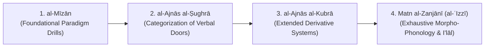

# Kitāb al-Zanjānī · al-ʿIzzī fī al-Ṣarf (متن الزنجاني / العزي في التصريف)
### *The Definitive Classical Primer on Arabic Morpho-Phonology and Verbal Derivations*
*Author: Imām ʿIzz al-Dīn Abū al-Maʿālī ʿAbd al-Wahhāb ibn Ibrāhīm al-Khazrajī al-Zanjānī (d. 655 AH / 1257 CE)*  
*Discipline: ʿIlm al-Ṣarf (Arabic Morphology) · Kanz al-Taḥqīq Library*

---

## Curricular Overview & Pedagogical Pedigree

**Matn al-Zanjānī** (commonly known in Islamic scholarship as **al-ʿIzzī fī al-Taṣrīf**) represents the foundational masterwork of classical Arabic morpho-phonology studied across the Islamic world for over seven centuries. Within traditional Dars pedagogy (particularly in the historic Nizami and Malabar Dars systems), it forms the fourth and culminating stage of foundational morphological training:



While earlier texts focus on memorizing paradigm tables (*Amthilah*), *Matn al-Zanjānī* unpacks the deep theoretical and phonetic mechanics (*ʿIlal*) of the Arabic language:
* Why root vowels shift, transport, or elide (*Iʿlāl bi-al-Qalb, bi-al-Naql, bi-al-Ḥadhf*).
* How coronal consonants assimilate (*Ibdāl* and *Idghām*).
* The precise phonetic and semantic differences across the seven root classes (*al-Aqsām al-Sabʿah*).

---

## Monograph Architecture & Directory Layout

```
zanjan/
├── README.md                      # This curricular guide & pedagogical syllabus
├── zanjan-al-matn.md              # Master Arabic Matn (100% Tashkīl, de-paginated, RTL)
├── zanjan-dars-ml.md              # Malayalam Dars pedagogical translation & commentary
├── zanjan-scholastic-en.md        # English academic philological edition & linguistic analysis
└── Notes/                         # Analytical study suite & reference vaults
    ├── Chapters/                  # Modular chapter-by-chapter dossiers (Units 01 - 24)
    │   ├── 00-index.md            # Interactive Master Index & Curriculum Guide
    │   ├── 01-muqaddimah-wa-mabadi.md       # Epistemology & 10 Canonical Principles of Sarf
    │   ├── 02-khutbah-wa-haqiqat-tasrif.md  # Definition of Tasrif & Primary Verb Taxonomies
    │   ├── 03-abwab-al-thulathi-al-mujarrad.md # The 6 Doors of the Bare Triliteral Verb
    │   ├── 04-al-thulathi-al-mazid-fih.md   # Augmented Triliteral Verbs & Augmentation Meanings
    │   ├── 05-al-rubai-al-mujarrad-wal-mulhaq.md # Quadriliteral Verbs & Morphological Annexes
    │   ├── 06-al-mutaaddi-wal-lazim.md      # Transitivity, Intransitivity & Causative Shifts
    │   └── ...                    # Subsequent analytical chapters (07 - 24)
    ├── Zanjan-Anshitah-Tadribiyyah.md # Separate Dedicated Dossier for Training Activities & Drills
    ├── Zanjan-Complete-Glossary.md    # 5-Column Trilingual Lexicon (150+ terms)
    ├── Zanjan-Paradigms.md            # Full 14-form conjugation tables for all 7 verb types
    ├── Zanjan-Rules-of-Ilal.md        # Systematic Morpho-Phonological Rule Engine
    ├── Zanjan-Trees.md                # Mermaid Concept Taxonomies & Morphological Trees
    └── Zanjan-Fest-Competition-Quiz-Bank.md # Tri-tier Dars Competition Bank (Ar/Ml/En)
```

---

## Master Chapter Syllabus

| Unit | Title (Arabic & English) | Physical Book Mapping | Pedagogical Focus |
|:---:|---|:---:|---|
| **01** | المبادئ العشرة ونشأة علم الصرف <br/> *The 10 Principles & Origins of Sarf* | pp. 5–15 | Epistemology, historical emergence (Muʿādh al-Harrāʾ), definition, subject, fruit. |
| **02** | خطبة المتن وحقيقة التصريف <br/> *Prologue & Definition of Tasrif* | pp. 16–20 | Linguistic change vs. morphological derivation; Triliteral/Quadriliteral, Bare/Augmented. |
| **03** | أبواب الثلاثي المجرد الستة <br/> *The 6 Doors of Bare Triliteral* | pp. 21–24 | The 6 Doors (*Faʿala - Yafʿulu* to *Faʿila - Yafʿilu*), guttural throat letters (*Ḥurūf al-Ḥalq*), anomalous verbs. |
| **04** | الثلاثي المزيد فيه ودلالات الزيادة <br/> *Augmented Triliterals & Semantic Values* | pp. 25–29 | 1-letter, 2-letter, and 3-letter augmentations; causativity (*Taʿdiyah*), reflexivity (*Muṭāwaʿah*). |
| **05** | الرباعي المجرد والمزيد وملحقاته <br/> *Quadriliterals & Morphological Annexes* | pp. 30–33 | *Faʿlala* (دَحْرَجَ), *Tafaʿlala* (تَدَحْرَجَ), *Ifʿanlala*, *Ifʿalalla*, and the 6 coordinated patterns (*Mulḥaqāt*). |
| **06** | المتعدي واللازم وتحويل الأفعال <br/> *Transitivity, Intransitivity & Shifts* | pp. 34–37 | Syntactic scope of verbs; transitivizing via Hamzah, Tashdīd, or preposition (*Ḥarf al-Jarr*). |
| **07** | تصريف الفعل الماضي <br/> *Conjugation of the Past Tense* | pp. 34–37 | Conjugation paradigms across 14 person-gender-number pronouns; vocalic adjustments. |
| **08** | تصريف الفعل المضارع وأحكامه <br/> *Conjugation of the Imperfect Verb* | pp. 38–43 | Prefixes of imperfect (*Anaytu*); indicative, subjunctive (*Nawāṣib*), and jussive (*Jawāzim*). |
| **09** | فعل الأمر وأحكام همزة الوصل <br/> *The Imperative Mood & Hamzat al-Wasl* | pp. 44–47 | Derivation from jussive; elision of imperfect prefix; voweling of connective Hamzah. |
| **10** | نونا التوكيد الثقيلة والخفيفة <br/> *The Heavy & Light Emphatic Nuns* | pp. 48–53 | Morphological affixation; resolving consonant clusters; pausal rules (*Waqf*). |
| **11** | اسما الفاعل والمفعول والصفة المشبهة <br/> *Participles & Verbal Adjectives* | pp. 54–59 | Active/Passive derivation from trilateral and augmented roots; *Mīm* prefixation. |
| **12** | المضاعف وأحكام الإدغام <br/> *Geminate Verbs & Assimilation Rules* | pp. 60–65 | Mandatory (*Wājib*), permissible (*Jā'iz*), and barred (*Mumtaniʿ*) assimilation (*Idghām*). |
| **13** | المعتل: أحكام المثال <br/> *The Weak Verb: Assimilated (al-Mithāl)* | pp. 66–70 | Wāwī and Yā'ī forms; deletion of initial Wāw in present and verbal nouns (*Waʿada / Yaʿidu / ʿIdah*). |
| **14** | المعتل: أحكام الأجوف <br/> *The Weak Verb: Hollow (al-Ajwaf)* | pp. 71–79 | Metathesis of weak radical to Alif; vowel deletion upon consonant cluster (*Qāla / Qulnā*). |
| **15** | المعتل: أحكام الناقص <br/> *The Weak Verb: Defective (al-Nāqiṣ)* | pp. 80–87 | Terminal vowel contraction; affixation of plural Wāw and feminine Tāʾ (*Ghazā / Ghazaw*). |
| **16** | المعتل: أحكام اللفيف <br/> *The Weak Verb: Doubly Weak (al-Lafīf)* | pp. 80–87 | Contiguous (*Maqrūn*) vs. Separated (*Mafrūq*); synthesis of Mithāl and Nāqiṣ rules (*Waqā / Yaqī / Qi*). |
| **17** | أحكام المهموز <br/> *The Hamzated Verb (al-Mahmūz)* | pp. 88–91 | Initial, medial, and final Hamzah; phonetic alleviation (*Takhfīf*); irregular imperatives (*Khudh, Kul, Mur*). |
| **18** | أسماء الزمان والمكان والآلة <br/> *Nouns of Space, Time & Instrument* | pp. 92–94 | Morphological templates (*Mafʿal, Mafʿil, Mifʿal, Mifʿāl, Mifʿalah*); semantic derivation. |
| **19** | التصغير وصيغتا المرة والهيئة <br/> *The Diminutive & Nouns of Instance/Manner* | pp. 92–94 | Diminutive patterns (*Fuʿayl, Fuʿayʿil*); unicity of action (*Faʿlah*) vs. manner of action (*Fiʿlah*). |
| **20** | قواعد الاعتلال الكبرى <br/> *The Master Rules of I'lāl* | pp. 95–96 | The 10 canonical rules governing vocalic transformation, transport, and apocope. |
| **21** | قواعد الإبدال الصرفي <br/> *The Master Rules of Ibdāl* | pp. 95–96 | Consonantal substitution; phonetic assimilation of the Tāʾ in *Iftaʿala* (*Iṣṭabara, Izdahama*). |
| **22** | الأنشطة التدريبية الشاملة <br/> *Comprehensive Training Activities & Drills* | Dedicated | Master answer key and interactive exercises from the annotators' edition. |
| **23** | المعجم الصرفي للألفاظ والجذور <br/> *Alphabetical Morphological Root Index* | pp. 97–105 | Concordance of every root, pattern, and derived form occurring in the textbook. |
| **24** | ثبت المراجع وتاريخ الفن <br/> *Classical Provenance & Commentaries* | p. 106 | Historical genealogy of Zanjānī commentaries (*al-Taftāzānī, al-Kīlānī, Ibn al-Ḥājib*). |

---

## Scholarly Provenance & Verified Authority

* **Source Text:** *Kitāb al-Ṣarf: al-Mīzān, al-Ajnās al-Ṣughrā, al-Ajnās al-Kubrā, Zanjān (maʿa al-Anshiṭah al-Tadrībiyyah)*, 3rd Edition, May 2019 / Ramaḍān 1440 AH.
* **Editors / Annotators:** Jaʿfar ʿUmar al-Saʿdī & Nawfal al-Sayyid ʿAlī al-ʿIrfānī.
* **Canonical Shamela Database Links:**
  * *Sharḥ al-Taṣrīf al-ʿIzzī* by Saʿd al-Dīn Masʿūd ibn ʿUmar al-Taftāzānī (ت 793 هـ): [المكتبة الشاملة: 36774](https://shamela.ws/book/36774).
  * *Tashīl al-Zanjānī / Sharḥ al-Kīlānī* by ʿAlī ibn Hishām al-Kīlānī (ت نحو 800 هـ): [المكتبة الشاملة: 36582](https://shamela.ws/book/36582).
* **Repository Standards Compliance:** Strictly audited against [SKILL.md](file:///Users/apple/Desktop/docs/Kanz-al-Tahqiq/Kanz-al-Tahqiq-pub/SKILL.md), [PROMPT_MASTER_SHEET.md](file:///Users/apple/Desktop/docs/Kanz-al-Tahqiq/Kanz-al-Tahqiq-pub/PROMPT_MASTER_SHEET.md), and [TRANSLITERATION_MASTER_SHEET.md](file:///Users/apple/Desktop/docs/Kanz-al-Tahqiq/Kanz-al-Tahqiq-pub/TRANSLITERATION_MASTER_SHEET.md).
