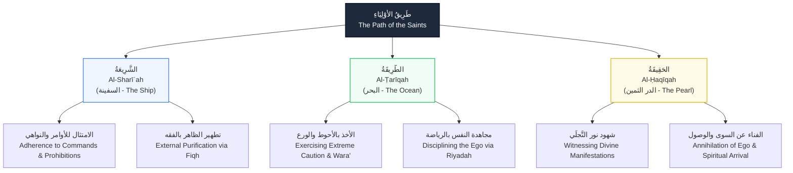

# خَرَائِطُ الْمَفَاهِيمِ وَشَجَرَاتُ السُّلُوكِ (Concept Trees & Taxonomies)
### Architectural Visualizations of the Sufi Curriculum in *Hidāyat al-Adhkiyāʾ*

---

## 1. The Tripartite Architecture of Islamic Spirituality

---

## 2. The 10 Progressive Stations (*Maqāmāt*) of the Salik

```mermaid
flowchart LR
    M1["1. التَّوْبَة<br/>Repentance"] --> M2["2. القَنَاعَة<br/>Contentment"]
    M2 --> M3["3. الزُّهْد<br/>Renunciation"]
    M3 --> M4["4. العِلْم<br/>Sacred Knowledge"]
    M4 --> M5["5. السُّنَّة<br/>Prophetic Sunnah"]
    M5 --> M6["6. التَّوَكُّل<br/>Divine Trust"]
    M6 --> M7["7. الإِخْلَاص<br/>Sincerity"]
    M7 --> M8["8. العُزْلَة<br/>Seclusion"]
    M8 --> M9["9. الصَّمْت<br/>Silence"]
    M9 --> M10["10. الذِّكْر<br/>Remembrance"]

    style M1 fill:#f8fafc,stroke:#64748b
    style M2 fill:#f8fafc,stroke:#64748b
    style M3 fill:#f8fafc,stroke:#64748b
    style M4 fill:#f8fafc,stroke:#64748b
    style M5 fill:#f8fafc,stroke:#64748b
    style M6 fill:#f8fafc,stroke:#64748b
    style M7 fill:#f8fafc,stroke:#64748b
    style M8 fill:#f8fafc,stroke:#64748b
    style M9 fill:#f8fafc,stroke:#64748b
    style M10 fill:#fef3c7,stroke:#d97706,stroke-width:2px
```

