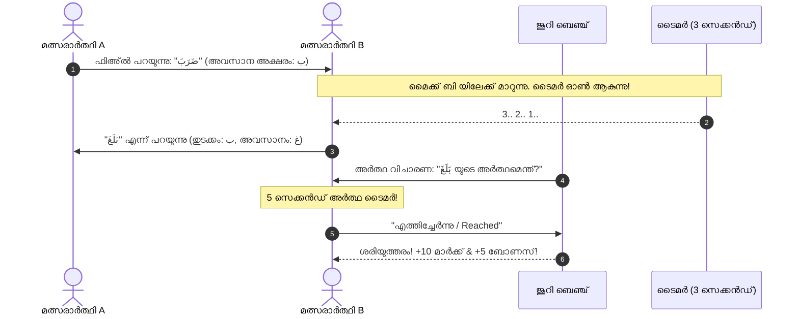
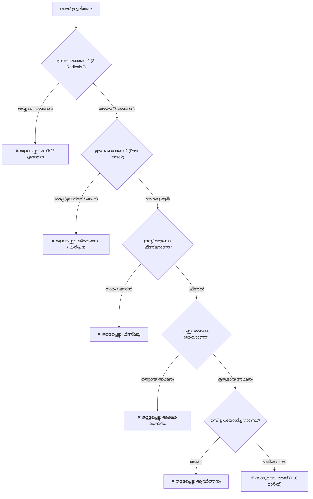

# പദപ്പയറ്റ് അറബി: സമ്പൂർണ്ണ ചാമ്പ്യൻഷിപ്പ് മാസ്റ്റർ ഗൈഡ്
# مُبَارَزَةُ الكَلِمَاتِ العَرَبِيَّة — الدَّلِيلُ الشَّامِلُ لِلْمُسَابَقَاتِ وَالمُبَارَزَاتِ اللُّغَوِيَّة
## Word Fight Arabic: The Definitive Championship Manual & Triliteral Combat Engine
### Alathurpadi Dars Mehrajan-26 (Items 128 / 147 / 169) & State Sahityotsav Standard

---

```
  ██╗    ██╗ ██████╗ ██████╗ ██████╗     ███████╗██╗ ██████╗ ██╗  ██╗████████╗
  ██║    ██║██╔═══██╗██╔══██╗██╔══██╗    ██╔════╝██║██╔════╝ ██║  ██║╚══██╔══╝
  ██║ █╗ ██║██║   ██║██████╔╝██║  ██║    █████╗  ██║██║  ███╗███████║   ██║   
  ██║███╗██║██║   ██║██╔══██╗██║  ██║    ██╔══╝  ██║██║   ██║██╔══██║   ██║   
  ╚███╔███╔╝╚██████╔╝██║  ██║██████╔╝    ██║     ██║╚██████╔╝██║  ██║   ██║   
   ╚══╝╚══╝  ╚═════╝ ╚═╝  ╚═╝╚═════╝     ╚═╝     ╚═╝ ╚═════╝ ╚═╝  ╚═╝   ╚═╝   
       A R A B I C   L I N G U I S T I C   D U E L   •   مُبَارَزَةُ الكَلِمَات
           "അറബി ഭാഷാ പദസമ്പത്തിന്റെ തത്സമയ പോരാട്ട വേദി"
```

> <div dir="rtl" lang="ar">
> 
> **«العِلْمُ صَيْدٌ وَالكِتَابَةُ قَيْدُهُ ... قَيِّدْ صُيُودَكَ بِالحِبَالِ الوَاثِقَةْ»**  
> *«അറിവ് ഒരു വേട്ടമൃഗമാണ്, എഴുത്ത് അതിനെ ബന്ധിക്കുന്ന കയറും; അതിനാൽ നിന്റെ വേട്ടകളെ വിശ്വസനീയമായ കയറുകൾ കൊണ്ട് വരിഞ്ഞുമുറുക്കുക.»*
> 
> </div>

---

## 📑 ഉള്ളടക്കം / Table of Contents

1. [ആമുഖവും ദർസ് പാരമ്പര്യവും (Introduction & Dars Pedagogy)](#1-ആമുഖവും-ദർസ്-പാരമ്പര്യവും)
2. [ഔദ്യോഗിക ഫെസ്റ്റ് മാന്വൽ ചട്ടങ്ങൾ (Official Tournament Regulations)](#2-ഔദ്യോഗിക-ഫെസ്റ്റ്-മാന്വൽ-ചട്ടങ്ങൾ)
3. [രൂപഭദ്രതാ നിയമങ്ങൾ: സുലാസീ മുജർറദും 6 ബാബുകളും (Morphological Engine & The 6 Abwab)](#3-രൂപഭദ്രതാ-നിയമങ്ങൾ-സുലാസീ-മുജർറദും-6-ബാബുകളും)
4. [മത്സര പ്രക്രിയയും സമയനിയന്ത്രണവും (Visual Duel Schematics)](#4-മത്സര-പ്രക്രിയയും-സമയനിയന്ത്രണവും)
5. [28 അക്ഷരങ്ങളുടെ സമഗ്ര പദശേഖരം (Complete 28-Letter Lexical Duel Bank)](#5-28-അക്ഷരങ്ങളുടെ-സമഗ്ര-പദശേഖരം)
6. [തന്ത്രപ്രധാനമായ യുദ്ധമുറകൾ: ട്രാപ്പ് ലെറ്ററുകളും കിൽ-ചെയിനുകളും (Tactical Duel Playbook)](#6-തന്ത്രപ്രധാനമായ-യുദ്ധമുറകൾ-ട്രാപ്പ്-ലെറ്ററുകളും-കിൽ-ചെയിനുകളും)
7. [ജൂറി റഫറി ബെഞ്ചും അഡ്ജുഡിക്കേഷൻ ഗൈഡും (Jury Adjudication & Scoring Protocol)](#7-ജൂറി-റഫറി-ബെഞ്ചും-അഡ്ജുഡിക്കേഷൻ-ഗൈഡും)
8. [പരിശീലന മുറകളും സ്പാറിംഗ് മൊഡ്യൂളുകളും (Sparring Drills & Training Regimen)](#8-പരിശീലന-മുറകളും-സ്പാറിംഗ്-മൊഡ്യൂളുകളും)

---

## 1. ആമുഖവും ദർസ് പാരമ്പര്യവും

കേരളത്തിലെ പരമ്പരാഗത ദർസുകളിലും ഇസ്ലാമിക് ആർട്സ് ഫെസ്റ്റുകളിലും (Mehrajan, Sahityotsav) ഏറ്റവും വാശിയേറിയതും കാണികളെ മുൾമുനയിൽ നിർത്തുന്നതുമായ ബുദ്ധിപരമായ മത്സരങ്ങളിലൊന്നാണ് **വേഡ് ഫൈറ്റ് അറബി (പദപ്പയറ്റ് / مُبَارَزَةُ الكَلِمَاتِ العَرَبِيَّة)**.

സാധാരണ ഇംഗ്ലീഷ് വേഡ് ഗെയിമുകളിൽ നിന്നോ അക്ഷരശ്ലോകങ്ങളിൽ നിന്നോ വേഡ് ഫൈറ്റിനെ വ്യത്യസ്തമാക്കുന്നത് അറബി ഭാഷയുടെ കർക്കശമായ **ഇൽമുസ്സ്വറഫ് (علم الصرف - സർഫിയ്യായ നിയമങ്ങൾ)** ആണ്. കേവലം വാക്കുകൾ ഓർത്തുവെക്കുന്നതിനപ്പുറം, ഒരു വാക്കിന്റെ വ്യാകരണപരമായ ഘടന, മൂന്നക്ഷര വേരുകൾ (Root Letters), സ്വരചിഹ്നങ്ങൾ (ഹറകത്തുകൾ), ക്ലാസിക്കൽ അർത്ഥങ്ങൾ എന്നിവ തത്സമയം വിവേചിച്ചറിയാനുള്ള പാണ്ഡിത്യമാണ് ഇവിടെ പരീക്ഷിക്കപ്പെടുന്നത്.

ഈ മാസ്റ്റർ ഷീറ്റ്, അലത്തൂർപടി ദർസ് മെഹ്‌റജാൻ-26 മാന്വലിലെ (ഇനങ്ങൾ: 128, 147, 169) നിർദ്ദേശങ്ങൾക്ക് 100% വിധേയമായി, ഭാഷാ വിദ്യാർത്ഥികൾക്കും പരിശീലകർക്കും ജൂറി അംഗങ്ങൾക്കും ഒരുപോലെ പ്രയോജനപ്പെടുന്ന വിധത്തിൽ ചിട്ടപ്പെടുത്തിയതാണ്.

---

## 2. ഔദ്യോഗിക ഫെസ്റ്റ് മാന്വൽ ചട്ടങ്ങൾ

<div dir="rtl" lang="ar">

### اللَّوَائِحُ الرَّسْمِيَّةُ لِمُسَابَقَةِ مُبَارَزَةِ الكَلِمَاتِ العَرَبِيَّة
*(ഫെസ്റ്റ് മാന്വൽ ഇനം 128, 147, 169 പ്രകാരമുള്ള ഔദ്യോഗിക ചട്ടങ്ങൾ)*

</div>

| ക്രമനമ്പർ | നിയമ വിഭാഗം | വിശദമായ വ്യവസ്ഥ | ലംഘനത്തിനുള്ള ശിക്ഷ |
| :---: | :--- | :--- | :--- |
| **01** | **വാക്കിന്റെ വ്യാകരണ വിഭാഗം** | **സുലാസീ മുജർറദായ മാളിയായ ഫിഅ്ലുകൾ (ثلاثي مجرد ماضي معلوم) മാത്രമേ ഉപയോഗിക്കാവൂ.** മൂന്ന് അസ്സൽ അക്ഷരങ്ങളുള്ള ഭൂതകാല ക്രിയകൾ മാത്രം. | വാക്ക് അസാധുവാകും (-5 മാർക്ക്). |
| **02** | **കണ്ണി നിയമം (Chain Rule)** | എതിരാളി പറഞ്ഞ ഫിഅ്‌ലിന്റെ അവസാന അക്ഷരം (ലാമുൽ ഫിഅ്‌ൽ - لام الفعل) കൊണ്ടായിരിക്കണം അടുത്ത മത്സരാർത്ഥി തന്റെ വാക്ക് തുടങ്ങേണ്ടത്. | തെറ്റായ അക്ഷരത്തിൽ തുടങ്ങിയാൽ അസാധുവാകും (-5 മാർക്ക്). |
| **03** | **സമയപരിധി (Timer)** | മൈക്ക് കയ്യിൽ ലഭിച്ചയുടൻ ക്ലോക്ക് ആരംഭിക്കും. ഓരോ ഊഴത്തിനും പരമാവധി **3 സെക്കൻഡ്** (സീനിയർ തലത്തിൽ 3 സെക്കൻഡ്, ജൂനിയർ തലത്തിൽ 5 സെക്കൻഡ്). | സമയം കഴിഞ്ഞാൽ എലിമിനേഷൻ അല്ലെങ്കിൽ 0 മാർക്ക്. |
| **04** | **അർത്ഥ വിചാരണ (Meaning Query)** | ജൂറിക്ക് എപ്പോൾ വേണമെങ്കിലും വാക്കിന്റെ അർത്ഥം ചോദിക്കാം. 5 സെക്കൻഡിനകം വ്യക്തമായ മലയാളം/ഇംഗ്ലീഷ് അർത്ഥം പറയണം. | അർത്ഥം തെറ്റിയാലോ അറിയാതിരുന്നാലോ **നെഗറ്റീവ് മാർക്ക് (-5)**. |
| **05** | **ആവർത്തന നിരോധനം (No Repetitions)** | ഒരു റൗണ്ടിൽ ഒരിക്കൽ ഉപയോഗിച്ച വാക്ക് അതേ റൗണ്ടിൽ വീണ്ടും ഉപയോഗിക്കാൻ പാടില്ല. | ആവർത്തിച്ചാൽ വാക്ക് തള്ളപ്പെടും (-5 മാർക്ക്). |
| **06** | **അംഗീകൃത നിഘണ്ടുക്കൾ (Lexical Authority)** | ജൂറിയുടെ അന്തിമ റഫറൻസ് **അൽ-മൻഹൽ (المنهل)**, **അൽ-മുൻജിദ് (المنجد في اللغة)**, **ലിസാനുൽ അറബ് (لسان العرب)** എന്നിവയായിരിക്കും. | നിഘണ്ടുവിലില്ലാത്ത വ്യാജ പദങ്ങൾക്ക് അയോഗ്യത. |

---

### 🚫 കർശനമായി നിരോധിക്കപ്പെട്ട പദവിഭാഗങ്ങൾ (Strictly Void Words)

താഴെ പറയുന്ന വിഭാഗങ്ങളിൽ പെട്ട പദങ്ങൾ ഉപയോഗിക്കുന്നത് നിയമവിരുദ്ധവും നെഗറ്റീവ് മാർക്കിന് കാരണവുമാണ്:

```
                          ┌─────────────────────────────────────┐
                          │    നിഷിദ്ധ പദങ്ങൾ (FORBIDDEN)      │
                          └──────────────────┬──────────────────┘
                                             │
      ┌──────────────────┬───────────────────┼───────────────────┬──────────────────┐
      ▼                  ▼                   ▼                   ▼                  ▼
1. മസീദ് ക്രിയകൾ     2. നാമങ്ങൾ/മസ്ദറുകൾ   3. വർത്തമാനം/ഭാവി     4. കൽപ്പനകൾ      5. മജ്ഹൂൽ/നാടൻ
(ثلاثي مزيد فيه)         (أسماء / مصادر)     (فعل مضارع)          (فعل أمر)        (مجهول / عامية)
 ഉദാ: أَكْرَمَ، تَقَبَّلَ    ഉദാ: كِتَاب، عِلْم    ഉദാ: يَكْتُبُ، يَضْرِبُ   ഉദാ: اِعْلَمْ، قُمْ  ഉദാ: كُتِبَ / شَافَ
```

1. **മസീദായ ഫിഅ്ലുകൾ (Augmented Verbs):** മൂന്നക്ഷരത്തിൽ കൂടുതൽ ഉള്ളതോ (ബാബ് ഇഫ്ആൽ, തഫ്ഈൽ, മുഫാഅല, ഇസ്തിഫ്ആൽ തുടങ്ങിയവ) അക്ഷരങ്ങൾ അധികരിപ്പിച്ചതോ ആയ ക്രിയകൾ (ഉദാ: أَخْرَجَ، قَاتَلَ، عَلَّمَ، اِسْتَغْفَرَ).
2. **റുബാഈ ഫിഅ്ലുകൾ (Quadriliteral Verbs):** നാല് അസ്സൽ അക്ഷരങ്ങളുള്ള ക്രിയകൾ (ഉദാ: دَحْرَجَ، زَلْزَلَ).
3. **മുളാരിആയ ക്രിയകൾ (Present/Future):** വർത്തമാനകാല ക്രിയകൾ പാടില്ല (ഉദാ: يَذْهَبُ).
4. **അംറായ ക്രിയകൾ (Imperative):** കൽപ്പന ക്രിയകൾ പാടില്ല (ഉദാ: اِذْهَبْ).
5. **മജ്ഹൂലായ ഫിഅ്ലുകൾ (Passive Voice):** കർമ്മണിപ്രയോഗ ക്രിയകൾ പാടില്ല (ഉദാ: ضُرِبَ).
6. **ഇസ്മുകൾ / മസ്ദറുകൾ (Nouns):** നാമങ്ങളോ ക്രിയാനാമങ്ങളോ പാടില്ല (ഉദാ: قَلَم، ذَهَاب).
7. **ആമ്മിയ്യ / നാടൻ പ്രയോഗങ്ങൾ:** അറബി ഭാഷാ വ്യാകരണത്തിന് നിരക്കാത്ത നാടോടി പ്രയോഗങ്ങൾ (ഉദാ: شَافَ، رَاحَ).

---

## 3. രൂപഭദ്രതാ നിയമങ്ങൾ: സുലാസീ മുജർറദും 6 ബാബുകളും

സുലാസീ മുജർറദിൽ (ثلاثي مجرد) ഭൂതകാല ക്രിയകൾ (മാളി) വരുന്നത് മൂന്ന് പ്രധാന വസ്‌നുകളിലാണ് (Weights):
1. **فَعَلَ** (ഐനുൽ ഫിഅ്‌ലിന് ഫത്‌ഹ്) — ഉദാ: نَصَرَ، ضَرَبَ، فَتَحَ
2. **فَعِلَ** (ഐനുൽ ഫിഅ്‌ലിന് കസ്‌റ്) — ഉദാ: عَلِمَ، شَرِبَ، سَمِعَ
3. **فَعُلَ** (ഐനുൽ ഫിഅ്‌ലിന് ളമ്മ്) — ഉദാ: حَسُنَ، كَرُمَ، شَرُفَ

### അബ്‍വാബുസ്സ്വറഫ് (The 6 Classical Conjugation Gates)

ഇൽമുസ്സ്വറഫിലെ പ്രശസ്തമായ ആറ് ബാബുകൾ താഴെ നൽകുന്നു:

<div dir="rtl" lang="ar">

| الرقم | الباب الصرفي | الوزن (ماضٍ - مضارع) | المثال المشهور | دلالته في المعنى |
| :---: | :---: | :---: | :---: | :--- |
| **1** | **بَابُ نَصَرَ** | فَعَلَ - يَفْعُلُ | **نَصَرَ - يَنْصُرُ** | الغالب فيه التعدية (സകർമ്മകം) |
| **2** | **بَابُ ضَرَبَ** | فَعَلَ - يَفْعِلُ | **ضَرَبَ - يَضْرِبُ** | يأتي متعدياً ولازماً |
| **3** | **بَابُ فَتَحَ** | فَعَلَ - يَفْعَلُ | **فَتَحَ - يَفْتَحُ** | شرطه حرف حلق في العين أو اللام |
| **4** | **بَابُ عَلِمَ** | فَعِلَ - يَفْعَلُ | **عَلِمَ - يَعْلَمُ** | غالب في العلل والأعراض والفرح والحزن |
| **5** | **بَابُ حَسُنَ** | فَعُلَ - يَفْعُلُ | **حَسُنَ - يَحْسُنُ** | لا يكون إلا لازماً في الطبائع والسجايا |
| **6** | **بَابُ حَسِبَ** | فَعِلَ - يَفْعِلُ | **حَسِبَ - يَحْسِبُ** | أقل الأبواب دوراناً في الكلام |

</div>

> **സർഫിലെ പ്രശസ്തമായ ശ്ലോകം (ഹറകത്തുകളുടെ ക്രമം ഓർക്കാൻ):**
> <div dir="rtl" lang="ar">
> 
> **فَتْحُ ضَمٍّ، فَتْحُ كَسْرٍ، فَتْحَتَانْ ... كَسْرُ فَتْحٍ، ضَمُّ ضَمٍّ، كَسْرَتَانْ**
> 
> </div>

---

### അൽ-അഖ്സാമുസ്സബ്അ (الأقسام السبعة — ഏഴ് ഇനം അക്ഷര ഘടനകൾ)

ഒരു പദപ്പയറ്റ് മത്സരാർത്ഥി അറിഞ്ഞിരിക്കേണ്ട 7 റൂട്ട് രൂപങ്ങൾ:

1. **സ്വഹീഹ് സാലിം (الصحيح السالم):** അസുഖാക്ഷരങ്ങളോ (ഇല്ലത്തിന്റെ അക്ഷരങ്ങൾ: و، ا، ي) ഹംസയോ തദ്‌ഈഫോ (ഇരട്ടിപ്പ്) ഇല്ലാത്തത്.  
   *(ഉദാ: كَتَبَ، جَلَسَ، فَتَحَ)*
2. **മഹ്മൂസ് (المهموز):** മൂന്നക്ഷരങ്ങളിൽ ഏതെങ്കിലും ഒന്നിൽ ഹംസ വരുന്നത്.  
   - മഹ്മൂസുൽ ഫാഅ്: **أَخَذَ، أَكَلَ، أَمَرَ**
   - മഹ്മൂസുൽ ഐൻ: **سَأَلَ، دَأَبَ، رَأَسَ**
   - മഹ്മൂസുൽ ലാം: **قَرَأَ، بَدَأَ، نَشَأَ**
3. **മുളഅ്അഫ് (المضعف):** ഐനും ലാമും ഒരേ അക്ഷരം ഇരട്ടിച്ചു വരുന്നത്. പദപ്പയറ്റിൽ ഇത് ഇദ്‌ഗാം ചെയ്ത് പറയണം.  
   *(ഉദാ: مَدَّ [اصل: مَدَدَ]، فَرَّ [اصل: فَرَرَ]، عَضَّ [اصل: عَضِضَ])*  
   > *നിയമക്കുറിപ്പ്: അവസാന അക്ഷരമായി കണക്കാക്കുന്നത് ഇരട്ടിച്ച അക്ഷരത്തെയാണ് (ഉദാ: مَدَّ യിൽ അവസാന അക്ഷരം ദാൽ - د).*
4. **മിസാൽ (المثال):** ഫാഉൽ ഫിഅ്‌ൽ ഇല്ലത്തിന്റെ അക്ഷരമാവുക.  
   - മിസാൽ വാവി: **وَعَدَ، وَجَدَ، وَقَعَ**
   - മിസാൽ യാഈ: **يَسَرَ، يَبِسَ، يَقِظَ**
5. **അജ്‌വഫ് (الأجوف):** ഐനുൽ ഫിഅ്‌ൽ ഇല്ലത്തിന്റെ അക്ഷരമാവുക.  
   *(ഉദാ: قَالَ [اصل: قَوَلَ]، بَاعَ [اصل: بَيَعَ]، خَافَ [اصل: خَوِفَ])*  
   > *നിയമക്കുറിപ്പ്: ഇവിടെ അവസാന അക്ഷരം ലാം ആണ് (ഉദാ: قَالَ ൽ അവസാന അക്ഷരം ലാം - ل).*
6. **നാഖിസ് (الناقص):** ലാമുൽ ഫിഅ്‌ൽ ഇല്ലത്തിന്റെ അക്ഷരമാവുക.  
   *(ഉദാ: دَعَا [اصل: دَعَوَ]، رَمَى [اصل: رَمَيَ]، رَضِيَ [اصل: رَضِوَ])*  
   > *നിയമക്കുറിപ്പ്: دَعَا അല്ലെങ്കിൽ رَمَى എന്ന് പറയുമ്പോൾ അവസാന അക്ഷരം അലിഫ്/യാഅ് ആണ്.*
7. **ലഫീഫ് (اللفيف):** രണ്ട് ഇല്ലത്തിന്റെ അക്ഷരങ്ങൾ ഒന്നിച്ച് വരുന്നത്.  
   - ലഫീഫ് മഫ്റൂഖ് (വേർപിരിഞ്ഞത്): **وَقَى، وَلِيَ، وَفَى**
   - ലഫീഫ് മഖ്‌റൂൻ (ചേർന്നു വന്നത്): **شَوَى، رَوَى، طَوَى**

---

## 4. മത്സര പ്രക്രിയയും സമയനിയന്ത്രണവും

മത്സര വേദിയിലെ ഒരു റൗണ്ടിന്റെ സമയഗതി താഴെ കൊടുത്ത സീക്വൻസ് ഡയഗ്രാമിൽ കാണാം:



---

### യോഗ്യതാ പരിശോധനാ ഫ്ലോചാർട്ട് (Morphological Gatekeeper)

ഒരു മത്സരാർത്ഥി വാക്ക് പറയുമ്പോൾ ജൂറിയും എതിരാളിയും മനസ്സിൽ നടത്തുന്ന തത്സമയ പരിശോധന:



---

## 5. 28 അക്ഷരങ്ങളുടെ സമഗ്ര പദശേഖരം
### Complete 28-Letter Lexical Duel Bank (أ إلى ي)

ഈ വിഭാഗത്തിൽ അറബിയിലെ 28 അക്ഷരങ്ങൾക്കും വേഡ് ഫൈറ്റിൽ അടിയന്തരമായി പ്രയോഗിക്കാവുന്ന അതിവേഗ ക്രിയകൾ (Rapid-Recall Verbs) പൂർണ്ണമായ ഹറകത്തുകളോടെ നൽകുന്നു. ഓരോ പദത്തിനും സർഫിലെ ബാബും, പരമ്പരാഗത ദർസ് മലയാള അർത്ഥവും, ഇംഗ്ലീഷ് അർത്ഥവും തന്ത്രപരമായ മൂല്യവും ചേർത്തിരിക്കുന്നു.

---

### 1. ഹംസ / അലിഫ് (أ)

<div dir="rtl" lang="ar">

| الرقم | الفِعْلُ المَاضِي | البَابُ الصَّرْفِيُّ | المَعْنَى بِالمَلَيَالَمِيَّةِ | English Meaning & Tactical Notes |
| :---: | :---: | :---: | :--- | :--- |
| **01** | **أَخَذَ** | فَعَلَ - يَفْعُلُ (نصر) | പിടിച്ചു, സ്വീകരിച്ചു | Took / seized. *(Ends in lethal trap: ذ).* |
| **02** | **أَكَلَ** | فَعَلَ - يَفْعُلُ (نصر) | ഭക്ഷിച്ചു | Ate. *(Ends in common Lām: ل).* |
| **03** | **أَمَرَ** | فَعَلَ - يَفْعُلُ (نصر) | കൽപ്പിച്ചു | Commanded / ordered. *(Ends in Rā': ر).* |
| **04** | **أَسِفَ** | فَعِلَ - يَفْعَلُ (علم) | ദുഃഖിച്ചു, ഖേദിച്ചു | Grieved / regretted. *(Ends in Fā': ف).* |
| **05** | **أَمِنَ** | فَعِلَ - يَفْعَلُ (علم) | നിർഭയനായി, വിശ്വസിച്ചു | Felt safe / trusted. *(Ends in Nūn: ن).* |
| **06** | **أَلِفَ** | فَعِلَ - يَفْعَلُ (علم) | ഇണങ്ങി, ശീലിച്ചു | Became accustomed / familiar. *(Ends in Fā': ف).* |
| **07** | **أَبَى** | فَعَلَ - يَفْعَلُ (فتح) | വിസമ്മതിച്ചു, നിരസിച്ചു | Refused / declined. *(Ends in Alif/Yā': ى).* |
| **08** | **أَثَرَ** | فَعَلَ - يَفْعُلُ (نصر) | ഉദ്ധരിച്ചു, പിന്തുടർന്നു | Transmitted / recounted. *(Ends in Rā': ر).* |
| **09** | **أَسَرَ** | فَعَلَ - يَفْعِلُ (ضرب) | തടവിലാക്കി, ബന്ധിച്ചു | Captured / took prisoner. *(Ends in Rā': ر).* |
| **10** | **أَفَلَ** | فَعَلَ - يَفْعُلُ (نصر) | അസ്തമിച്ചു, മറഞ്ഞു | Set / disappeared. *(Quranic: 6:76).* |

</div>

---

### 2. ബാഅ് (ب)

<div dir="rtl" lang="ar">

| الرقم | الفِعْلُ المَاضِي | البَابُ الصَّرْفِيُّ | المَعْنَى بِالمَلَيَالَمِيَّةِ | English Meaning & Tactical Notes |
| :---: | :---: | :---: | :--- | :--- |
| **01** | **بَلَغَ** | فَعَلَ - يَفْعُلُ (نصر) | എത്തിച്ചേർന്നു, പ്രായപൂർത്തിയായി | Reached / attained. *(Ends in trap: غ).* |
| **02** | **بَعَثَ** | فَعَلَ - يَفْعَلُ (فتح) | നിയോഗിച്ചു, പുനരുജ്ജീവിപ്പിച്ചു | Sent / resurrected. *(Ends in lethal trap: ث).* |
| **03** | **بَسَطَ** | فَعَلَ - يَفْعُلُ (نصر) | വിരിച്ചു, വിശാലമാക്കി | Spread / stretched out. *(Ends in Ṭā': ط).* |
| **04** | **بَرِئَ** | فَعِلَ - يَفْعَلُ (علم) | മുക്തനായി, ഒഴിവായി | Became free / innocent. *(Ends in Hamzah: ء).* |
| **05** | **بَصُرَ** | فَعُلَ - يَفْعُلُ (حسن) | കണ്ടു, ഉൾക്കാഴ്ചയുണ്ടായി | Saw / perceived mentally. *(Ends in Rā': ر).* |
| **06** | **بَذَلَ** | فَعَلَ - يَفْعُلُ (نصر) | ചെലവഴിച്ചു, ഔദാര്യപൂർവ്വം നൽകി | Spent generously. *(Ends in Lām: ل).* |
| **07** | **بَخِلَ** | فَعِلَ - يَفْعَلُ (علم) | പിശുക്കുകാട്ടി | Was stingy / miserly. *(Ends in Lām: ل).* |
| **08** | **بَدَأَ** | فَعَلَ - يَفْعَلُ (فتح) | ആരംഭിച്ചു | Began / commenced. *(Ends in Hamzah: أ).* |
| **09** | **بَنَى** | فَعَلَ - يَفْعِلُ (ضرب) | നിർമ്മിച്ചു, പണിതു | Built / constructed. *(Ends in Alif/Yā': ى).* |
| **10** | **بَرَكَ** | فَعَلَ - يَفْعُلُ (نصر) | ഒട്ടകം മുട്ടുകുത്തി | Kneeled down (camel). *(Ends in Kāf: ك).* |

</div>

---

### 3. താഅ് (ت)

<div dir="rtl" lang="ar">

| الرقم | الفِعْلُ المَاضِي | البَابُ الصَّرْفِيُّ | المَعْنَى بِالمَلَيَالَمِيَّةِ | English Meaning & Tactical Notes |
| :---: | :---: | :---: | :--- | :--- |
| **01** | **تَرَكَ** | فَعَلَ - يَفْعُلُ (نصر) | ഉപേക്ഷിച്ചു | Left / abandoned. *(Ends in Kāf: ك).* |
| **02** | **تَبِعَ** | فَعِلَ - يَفْعَلُ (علم) | പിന്തുടർന്നു | Followed. *(Ends in ʿAyn: ع).* |
| **03** | **تَلَا** | فَعَلَ - يَفْعُلُ (نصر) | പാരായണം ചെയ്തു | Recited / read aloud. *(Ends in Alif: ا).* |
| **04** | **تَابَ** | فَعَلَ - يَفْعُلُ (نصر) | പശ്ചാത്തപിച്ചു | Repented. *(Ends in Bā': ب).* |
| **05** | **تَجَرَ** | فَعَلَ - يَفْعُلُ (نصر) | കച്ചവടം നടത്തി | Traded / engaged in commerce. *(Ends in Rā': ر).* |
| **06** | **تَمَّ** | فَعَلَ - يَفِمُّ (ضرب/نصر) | പൂർത്തിയായി | Was completed. *(Muḍaʿʿaf, ends in Mīm: م).* |
| **07** | **تَعِبَ** | فَعِلَ - يَفْعَلُ (علم) | ക്ഷീണിച്ചു | Grew tired / weary. *(Ends in Bā': ب).* |
| **08** | **تَلِفَ** | فَعِلَ - يَفْعَلُ (علم) | നശിച്ചു, പാഴായി | Was damaged / perished. *(Ends in Fā': ف).* |
| **09** | **تَهِمَ** | فَعِلَ - يَفْعَلُ (علم) | സംശയിച്ചു | Suspected. *(Ends in Mīm: م).* |
| **10** | **تَاقَ** | فَعَلَ - يَفُوقُ (نصر) | അതിയായി കൊതിച്ചു | Yearned / longed for. *(Ends in Qāf: ق).* |

</div>

---

### 4. സാഅ് (ث) — *തന്ത്രപ്രധാനമായ അക്ഷരം (Lethal Trap & Counter)*

<div dir="rtl" lang="ar">

| الرقم | الفِعْلُ المَاضِي | البَابُ الصَّرْفِيُّ | المَعْنَى بِالمَلَيَالَمِيَّةِ | English Meaning & Tactical Notes |
| :---: | :---: | :---: | :--- | :--- |
| **01** | **ثَبَتَ** | فَعَلَ - يَفْعُلُ (نصر) | ഉറച്ചുനിന്നു | Remained firm / steadfast. *(Ends in Tā': ت).* |
| **02** | **ثَقُلَ** | فَعُلَ - يَفْعُلُ (حسن) | ഭാരമുള്ളതായി | Grew heavy. *(Ends in Lām: ل).* |
| **03** | **ثَقَبَ** | فَعَلَ - يَفْعُلُ (نصر) | തുളച്ചു, ദ്വാരമുണ്ടാക്കി | Pierced / perforated. *(Ends in Bā': ب).* |
| **04** | **ثَارَ** | فَعَلَ - يَثُورُ (نصر) | വിപ്ലവം ചെയ്തു, ഇളകിമറിഞ്ഞു | Revolted / stirred up. *(Ends in Rā': ر).* |
| **05** | **ثَلَجَ** | فَعَلَ - يَفْعُلُ (نصر) | മഞ്ഞുവീണു, തണുത്തു | Froze / snowed. *(Ends in Jīm: ج).* |
| **06** | **ثَمَرَ** | فَعَلَ - يَفْعُلُ (نصر) | ഫലം നൽകി | Bore fruit. *(Ends in Rā': ر).* |
| **07** | **ثَنَى** | فَعَلَ - يَثْنِي (ضرب) | മടക്കി, ഇരട്ടിപ്പിച്ചു | Folded / doubled. *(Ends in Alif/Yā': ى).* |
| **08** | **ثَوَى** | فَعَلَ - يَثْوِي (ضرب) | താമസിച്ചു, പാർത്തു | Dwelt / settled. *(Ends in Alif/Yā': ى).* |
| **09** | **ثَبَطَ** | فَعَلَ - يَفْعُلُ (نصر) | മടിപ്പിച്ചു, തടഞ്ഞു | Discouraged / held back. *(Ends in Ṭā': ط).* |
| **10** | **ثَلَبَ** | فَعَلَ - يَفْعِلُ (ضرب) | ആക്ഷേപിച്ചു, ന്യൂനത പറഞ്ഞു | Defamed / criticized. *(Ends in Bā': ب).* |

</div>

---

### 5. ജീം (ج)

<div dir="rtl" lang="ar">

| الرقم | الفِعْلُ المَاضِي | البَابُ الصَّرْفِيُّ | المَعْنَى بِالمَلَيَالَمِيَّةِ | English Meaning & Tactical Notes |
| :---: | :---: | :---: | :--- | :--- |
| **01** | **جَلَسَ** | فَعَلَ - يَفْعِلُ (ضرب) | ഇരുന്നു | Sat down. *(Ends in Sīn: س).* |
| **02** | **جَمَعَ** | فَعَلَ - يَفْعَلُ (فتح) | ഒരുമിച്ചുകൂട്ടി | Gathered / collected. *(Ends in ʿAyn: ع).* |
| **03** | **جَحَظَ** | فَعَلَ - يَفْعَلُ (فتح) | കണ്ണ് പുറത്തേക്ക് തള്ളി | Bulged (eyes). *(Ends in supreme trap: ظ).* |
| **04** | **جَزَى** | فَعَلَ - يَجْزِي (ضرب) | പ്രതിഫലം നൽകി | Rewarded / repaid. *(Ends in Alif/Yā': ى).* |
| **05** | **جَهِلَ** | فَعِلَ - يَفْعَلُ (علم) | വിവരമില്ലാത്തവനായി | Was ignorant. *(Ends in Lām: ل).* |
| **06** | **جَادَ** | فَعَلَ - يَجُودُ (نصر) | ഔദാര്യം കാണിച്ചു | Was generous. *(Ends in Dāl: د).* |
| **07** | **جَرَى** | فَعَلَ - يَجْرِي (ضرب) | ഒഴുകി, ഓടി | Ran / flowed. *(Ends in Alif/Yā': ى).* |
| **08** | **جَذَبَ** | فَعَلَ - يَفْعِلُ (ضرب) | ആകർഷിച്ചു, വലിച്ചെടുത്തു | Attracted / pulled. *(Ends in Bā': ب).* |
| **09** | **جَفَّ** | فَعَلَ - يَجِفُّ (ضرب) | ഉണങ്ങി | Dried up. *(Ends in Fā': ف).* |
| **10** | **جَبَرَ** | فَعَلَ - يَفْعُلُ (نصر) | എല്ല് കൂട്ടിപ്പൊരുതി, പരിഹരിച്ചു | Set (bone) / restored. *(Ends in Rā': ر).* |

</div>

---

### 6. ഹാഅ് (ح)

<div dir="rtl" lang="ar">

| الرقم | الفِعْلُ المَاضِي | البَابُ الصَّرْفِيُّ | المَعْنَى بِالمَلَيَالَمِيَّةِ | English Meaning & Tactical Notes |
| :---: | :---: | :---: | :--- | :--- |
| **01** | **حَفِظَ** | فَعِلَ - يَفْعَلُ (علم) | സൂക്ഷിച്ചു, മനഃപാഠമാക്കി | Guarded / memorized. *(Ends in lethal trap: ظ).* |
| **02** | **حَرَثَ** | فَعَلَ - يَفْعُلُ (نصر) | നിലമുഴുതു | Ploughed / tilled. *(Ends in lethal trap: ث).* |
| **03** | **حَسُنَ** | فَعُلَ - يَفْعُلُ (حسن) | ഭംഗിയായി, നന്മയുള്ളതായി | Was good / handsome. *(Ends in Nūn: ن).* |
| **04** | **حَكَمَ** | فَعَلَ - يَفْعُلُ (نصر) | വിധിപറഞ്ഞു | Judged / governed. *(Ends in Mīm: م).* |
| **05** | **حَمِدَ** | فَعِلَ - يَفْعَلُ (علم) | സ്തുതിച്ചു | Praised. *(Ends in Dāl: د).* |
| **06** | **حَزِنَ** | فَعِلَ - يَفْعَلُ (علم) | വ്യസനിച്ചു | Grieved / mourned. *(Ends in Nūn: ن).* |
| **07** | **حَلَفَ** | فَعَلَ - يَفْعِلُ (ضرب) | സത്യം ചെയ്തു | Swore / took an oath. *(Ends in Fā': ف).* |
| **08** | **حَمَلَ** | فَعَلَ - يَفْعِلُ (ضرب) | ചുമന്നു | Carried / bore. *(Ends in Lām: ل).* |
| **09** | **حَبَّ** | فَعِلَ - يَحَبُّ (علم) | സ്നേഹിച്ചു | Loved. *(Muḍaʿʿaf, ends in Bā': ب).* |
| **10** | **حَرَمَ** | فَعَلَ - يَفْعِرُ (ضرب) | തടഞ്ഞു, നിഷേധിച്ചു | Deprived / barred. *(Ends in Rā': ر).* |

</div>

---

### 7. ഖാഅ് (خ) — *തന്ത്രപ്രധാനമായ അക്ഷരം (Rare Consonant & Lethal Exit)*

<div dir="rtl" lang="ar">

| الرقم | الفِعْلُ المَاضِي | البَابُ الصَّرْفِيُّ | المَعْنَى بِالمَلَيَالَمِيَّةِ | English Meaning & Tactical Notes |
| :---: | :---: | :---: | :--- | :--- |
| **01** | **خَرَجَ** | فَعَلَ - يَفْعُلُ (نصر) | പുറത്തുപോയി | Went out / exited. *(Ends in Jīm: ج).* |
| **02** | **خَلَقَ** | فَعَلَ - يَفْعُلُ (نصر) | സൃഷ്ടിച്ചു | Created. *(Ends in Qāf: ق).* |
| **03** | **خَافَ** | فَعِلَ - يَخَافُ (علم) | ഭയപ്പെട്ടു | Feared. *(Ends in Fā': ف).* |
| **04** | **خَتَمَ** | فَعَلَ - يَفْعِمُ (ضرب) | പൂർത്തിയാക്കി, മുദ്രവെച്ചു | Sealed / concluded. *(Ends in Mīm: م).* |
| **05** | **خَدَمَ** | فَعَلَ - يَفْعِمُ (ضرب) | സേവിച്ചു | Served. *(Ends in Mīm: م).* |
| **06** | **خَشِيَ** | فَعِلَ - يَخْشَى (علم) | ഭയഭക്തി കാണിച്ചു | Feared with reverence. *(Ends in Alif/Yā': ى).* |
| **07** | **خَضَعَ** | فَعَلَ - يَفْعَلُ (فتح) | കീഴ്പ്പെട്ടു, താഴ്മകാണിച്ചു | Submitted / bowed down. *(Ends in ʿAyn: ع).* |
| **08** | **خَانَ** | فَعَلَ - يَخُونُ (نصر) | വഞ്ചിച്ചു | Betrayed. *(Ends in Nūn: ن).* |
| **09** | **خَبَزَ** | فَعَلَ - يَفْعِزُ (ضرب) | റൊട്ടിയുണ്ടാക്കി | Baked bread. *(Ends in Zāy: ز).* |
| **10** | **خَرَّ** | فَعَلَ - يَخِرُّ (ضرب) | സാഷ്ടാംഗം വീണു | Fell prostrate. *(Quranic: 19:58).* |

</div>

---

### 8. ദാൽ (د)

<div dir="rtl" lang="ar">

| الرقم | الفِعْلُ المَاضِي | البَابُ الصَّرْفِيُّ | المَعْنَى بِالمَلَيَالَمِيَّةِ | English Meaning & Tactical Notes |
| :---: | :---: | :---: | :--- | :--- |
| **01** | **دَخَلَ** | فَعَلَ - يَفْعُلُ (نصر) | പ്രവേശിച്ചു | Entered. *(Ends in Lām: ل).* |
| **02** | **دَعَا** | فَعَلَ - يَدْعُو (نصر) | പ്രാർത്ഥിച്ചു, ക്ഷണിച്ചു | Prayed / called upon. *(Ends in Alif: ا).* |
| **03** | **دَمَغَ** | فَعَلَ - يَفْدَمُ (فتح) | തലയോട്ടി തകർത്തു, ബാത്വിലിനെ തകർത്തു | Crushed / refuted falsehood. *(Ends in trap: غ).* |
| **04** | **دَرَسَ** | فَعَلَ - يَفْعُلُ (نصر) | പഠിച്ചു | Studied / learned. *(Ends in Sīn: س).* |
| **05** | **دَفَعَ** | فَعَلَ - يَفْعَلُ (فتح) | തള്ളിനീക്കി, പ്രതിരോധിച്ചു | Pushed / repelled. *(Ends in ʿAyn: ع).* |
| **06** | **دَلَّ** | فَعَلَ - يَدُلُّ (نصر) | വഴികാട്ടി | Guided / directed. *(Ends in Lām: ل).* |
| **07** | **دَانَ** | فَعَلَ - يَدِينُ (ضرب) | കടം വാങ്ങി, കീഴ്പ്പെട്ടു | Borrowed / submitted. *(Ends in Nūn: ن).* |
| **08** | **دَفَنَ** | فَعَلَ - يَفْدِنُ (ضرب) | അടക്കം ചെയ്തു | Buried. *(Ends in Nūn: ن).* |
| **09** | **دَارَ** | فَعَلَ - يَدُورُ (نصر) | ചുറ്റിത്തിരിഞ്ഞു | Rotated / revolved. *(Ends in Rā': ر).* |
| **10** | **دَهَنَ** | فَعَلَ - يَفْدُنُ (نصر) | എണ്ണ തേച്ചു | Anointed / greased. *(Ends in Nūn: ن).* |

</div>

---

### 9. ദാൽ (ذ) — *തന്ത്രപ്രധാനമായ അക്ഷരം (Lethal Trap & Counter)*

<div dir="rtl" lang="ar">

| الرقم | الفِعْلُ المَاضِي | البَابُ الصَّرْفِيُّ | المَعْنَى بِالمَلَيَالَمِيَّةِ | English Meaning & Tactical Notes |
| :---: | :---: | :---: | :--- | :--- |
| **01** | **ذَهَبَ** | فَعَلَ - يَفْعَلُ (فتح) | പോയി | Went / departed. *(Ends in Bā': ب).* |
| **02** | **ذَاقَ** | فَعَلَ - يَذُوقُ (نصر) | രുചിച്ചു | Tasted. *(Ends in Qāf: ق).* |
| **03** | **ذَكَرَ** | فَعَلَ - يَفْعُلُ (نصر) | അനുസ്മരിച്ചു, പറഞ്ഞു | Remembered / mentioned. *(Ends in Rā': ر).* |
| **04** | **ذَبَحَ** | فَعَلَ - يَفْعَلُ (فتح) | അറുത്തു | Slaughtered. *(Ends in Ḥā': ح).* |
| **05** | **ذَلَّ** | فَعَلَ - يَذِلُّ (ضرب) | നിന്ദ്യനായി, കീഴൊതുങ്ങി | Became humiliated / meek. *(Ends in Lām: ل).* |
| **06** | **ذَاعَ** | فَعَلَ - يَذِيعُ (ضرب) | പ്രചരിച്ചു, പരസ്യമായി | Spread / became widespread. *(Ends in ʿAyn: ع).* |
| **07** | **ذَابَ** | فَعَلَ - يَذُوبُ (نصر) | ഉരുകി | Melted / dissolved. *(Ends in Bā': ب).* |
| **08** | **ذَرَعَ** | فَعَلَ - يَفْعَلُ (فتح) | അളന്നു, മുറിച്ചുകടന്നു | Measured / traversed. *(Ends in ʿAyn: ع).* |
| **09** | **ذَمَّ** | فَعَلَ - يَذُمُّ (نصر) | ആക്ഷേപിച്ചു | Blamed / condemned. *(Ends in Mīm: م).* |
| **10** | **ذَرَا** | فَعَلَ - يَذْرُو (نصر) | കാറ്റിൽ പറത്തി | Scattered / blew away. *(Quranic: 18:45).* |

</div>

---

### 10. റാഅ് (ر)

<div dir="rtl" lang="ar">

| الرقم | الفِعْلُ المَاضِي | البَابُ الصَّرْفِيُّ | المَعْنَى بِالمَلَيَالَمِيَّةِ | English Meaning & Tactical Notes |
| :---: | :---: | :---: | :--- | :--- |
| **01** | **رَزَقَ** | فَعَلَ - يَفْعُلُ (نصر) | ഉപജീവനം നൽകി | Provided sustenance. *(Ends in Qāf: ق).* |
| **02** | **رَفَضَ** | فَعَلَ - يَفْعُلُ (نصر) | നിരാകരിച്ചു | Rejected / refused. *(Ends in lethal trap: ض).* |
| **03** | **رَأَى** | فَعَلَ - يَرَى (فتح) | കണ്ടു | Saw / perceived. *(Ends in Alif/Yā': ى).* |
| **04** | **رَحِمَ** | فَعِلَ - يَفْعَلُ (علم) | കരുണ കാണിച്ചു | Showed mercy. *(Ends in Mīm: م).* |
| **05** | **رَجَعَ** | فَعَلَ - يَفْعِلُ (ضرب) | മടങ്ങി | Returned. *(Ends in ʿAyn: ع).* |
| **06** | **رَضِيَ** | فَعِلَ - يَرْضَى (علم) | തൃപ്തിപ്പെട്ടു | Was pleased / satisfied. *(Ends in Alif/Yā': ى).* |
| **07** | **رَمَى** | فَعَلَ - يَرْمِي (ضرب) | എറിഞ്ഞു | Threw / shot. *(Ends in Alif/Yā': ى).* |
| **08** | **رَكِبَ** | فَعِلَ - يَفْعَلُ (علم) | വാഹനത്തിൽ കയറി | Rode / mounted. *(Ends in Bā': ب).* |
| **09** | **رَفَعَ** | فَعَلَ - يَفْعَلُ (فتح) | ഉയർത്തി | Raised / elevated. *(Ends in ʿAyn: ع).* |
| **10** | **رَبِحَ** | فَعِلَ - يَفْعَلُ (علم) | ലാഭമുണ്ടാക്കി | Profited / gained. *(Ends in Ḥā': ح).* |

</div>

---

### 11. സാഅ് / സായ് (ز)

<div dir="rtl" lang="ar">

| الرقم | الفِعْلُ المَاضِي | البَابُ الصَّرْفِيُّ | المَعْنَى بِالمَلَيَالَمِيَّةِ | English Meaning & Tactical Notes |
| :---: | :---: | :---: | :--- | :--- |
| **01** | **زَادَ** | فَعَلَ - يَزِيدُ (ضرب) | വർദ്ധിച്ചു, അധികരിപ്പിച്ചു | Increased. *(Ends in Dāl: د).* |
| **02** | **زَارَ** | فَعَلَ - يَزُورُ (نصر) | സന്ദർശിച്ചു | Visited. *(Ends in Rā': ر).* |
| **03** | **زَرَعَ** | فَعَلَ - يَفْعَلُ (فتح) | കൃഷിചെയ്തു | Sowed / cultivated. *(Ends in ʿAyn: ع).* |
| **04** | **زَلَّ** | فَعَلَ - يَزِلُّ (ضرب) | കാലിടറി | Slipped / erred. *(Ends in Lām: ل).* |
| **05** | **زَهِدَ** | فَعِلَ - يَفْعَلُ (علم) | ലൗകികവിരക്തി കാണിച്ചു | Renounced worldly desires. *(Ends in Dāl: د).* |
| **06** | **زَجَرَ** | فَعَلَ - يَفْعُلُ (نصر) | ശാസിച്ചു, വിലക്കി | Rebuked / restrained. *(Ends in Rā': ر).* |
| **07** | **زَعَمَ** | فَعَلَ - يَفْعُمُ (نصر) | വാദിച്ചു | Claimed / asserted. *(Ends in Mīm: م).* |
| **08** | **زَفَّ** | فَعَلَ - يَزِفُّ (ضرب) | തിടുക്കം കൂട്ടി | Hurried along. *(Ends in Fā': ف).* |
| **09** | **زَوَى** | فَعَلَ - يَزْوِي (ضرب) | ചുരുക്കിക്കൂട്ടി, മാറ്റിനിർത്തി | Shrank / folded up. *(Ends in Alif/Yā': ى).* |
| **10** | **زَهَقَ** | فَعَلَ - يَفْعَقُ (فتح) | നശിച്ചുപോയി | Vanished / perished. *(Quranic: 17:81).* |

</div>

---

### 12. സീൻ (س)

<div dir="rtl" lang="ar">

| الرقم | الفِعْلُ المَاضِي | البَابُ الصَّرْفِيُّ | المَعْنَى بِالمَلَيَالَمِيَّةِ | English Meaning & Tactical Notes |
| :---: | :---: | :---: | :--- | :--- |
| **01** | **سَمِعَ** | فَعِلَ - يَسْمَعُ (علم) | കേട്ടു | Heard / listened. *(Ends in ʿAyn: ع).* |
| **02** | **سَأَلَ** | فَعَلَ - يَسْأَلُ (فتح) | ചോദിച്ചു | Asked / inquired. *(Ends in Lām: ل).* |
| **03** | **سَلَخَ** | فَعَلَ - يَفْعَلُ (فتح) | തോലുരിച്ചു, ഉരിഞ്ഞുമാറ്റി | Skinned / stripped off. *(Ends in trap: خ).* |
| **04** | **سَجَدَ** | فَعَلَ - يَسْجُدُ (نصر) | സാഷ്ടാംഗം പ്രണമിച്ചു | Prostrated. *(Ends in Dāl: د).* |
| **05** | **سَرَقَ** | فَعَلَ - يَسْرِقُ (ضرب) | മോഷ്ടിച്ചു | Stole. *(Ends in Qāf: ق).* |
| **06** | **سَكَنَ** | فَعَلَ - يَسْكُنُ (نصر) | താമസിച്ചു, അടങ്ങി | Dwelt / became calm. *(Ends in Nūn: ن).* |
| **07** | **سَلِمَ** | فَعِلَ - يَسْلَمُ (علم) | രക്ഷപ്പെട്ടു, സമാധാനത്തിലായി | Was safe / sound. *(Ends in Mīm: م).* |
| **08** | **سَارَ** | فَعَلَ - يَسِيرُ (ضرب) | സഞ്ചരിച്ചു | Walked / traveled. *(Ends in Rā': ر).* |
| **09** | **سَبَقَ** | فَعَلَ - يَسْبِقُ (ضرب) | മുൻകടന്നു | Preceded / outran. *(Ends in Qāf: ق).* |
| **10** | **سَكَبَ** | فَعَلَ - يَسْكُبُ (نصر) | ചൊരിഞ്ഞു, പകർന്നു | Poured out. *(Ends in Bā': ب).* |

</div>

---

### 13. ഷീൻ (ش)

<div dir="rtl" lang="ar">

| الرقم | الفِعْلُ المَاضِي | البَابُ الصَّرْفِيُّ | المَعْنَى بِالمَلَيَالَمِيَّةِ | English Meaning & Tactical Notes |
| :---: | :---: | :---: | :--- | :--- |
| **01** | **شَرِبَ** | فَعِلَ - يَشْرَبُ (علم) | കുടിച്ചു | Drank. *(Ends in Bā': ب).* |
| **02** | **شَكَرَ** | فَعَلَ - يَشْكُرُ (نصر) | നന്ദി രേഖപ്പെടുത്തി | Thanked / was grateful. *(Ends in Rā': ر).* |
| **03** | **شَهِدَ** | فَعِلَ - يَشْهَدُ (علم) | സാക്ഷ്യം വഹിച്ചു | Witnessed / testified. *(Ends in Dāl: د).* |
| **04** | **شَرَحَ** | فَعَلَ - يَشْرَحُ (فتح) | വിശദീകരിച്ചു, വിശാലമാക്കി | Explained / opened up. *(Ends in Ḥā': ح).* |
| **05** | **شَرُفَ** | فَعُلَ - يَشْرُفُ (حسن) | ആദരണീയനായി | Was noble / honored. *(Ends in Fā': ف).* |
| **06** | **شَدَّ** | فَعَلَ - يَشُدُّ (نصر) | ശക്തിപ്പെടുത്തി, മുറുക്കി | Tightened / strengthened. *(Ends in Dāl: د).* |
| **07** | **شَاءَ** | فَعَلَ - يَشَاءُ (فتح) | ഉദ്ദേശിച്ചു | Willed / wished. *(Ends in Hamzah: ء).* |
| **08** | **شَقَّ** | فَعَلَ - يَشُقُّ (نصر) | പിളർന്നു, പ്രയാസമായി | Split / caused hardship. *(Ends in Qāf: ق).* |
| **09** | **شَغَلَ** | فَعَلَ - يَشْغَلُ (فتح) | വ്യാപൃതനാക്കി | Preoccupied / engaged. *(Ends in Lām: ل).* |
| **10** | **شَوَى** | فَعَلَ - يَشْوِي (ضرب) | ചുട്ടെടുത്തു | Grilled / roasted. *(Ends in Alif/Yā': ى).* |

</div>

---

### 14. സ്വാദ് (ص)

<div dir="rtl" lang="ar">

| الرقم | الفِعْلُ المَاضِي | البَابُ الصَّرْفِيُّ | المَعْنَى بِالمَلَيَالَمِيَّةِ | English Meaning & Tactical Notes |
| :---: | :---: | :---: | :--- | :--- |
| **01** | **صَبَرَ** | فَعَلَ - يَصْبِرُ (ضرب) | ക്ഷമിച്ചു | Was patient. *(Ends in Rā': ر).* |
| **02** | **صَدَقَ** | فَعَلَ - يَصْدُقُ (نصر) | സത്യം പറഞ്ഞു | Spoke the truth. *(Ends in Qāf: ق).* |
| **03** | **صَبَغَ** | فَعَلَ - يَصْبُغُ (نصر) | ചായം പൂശി, വർണ്ണമേകി | Dyed / colored. *(Ends in lethal trap: غ).* |
| **04** | **صَرَخَ** | فَعَلَ - يَصْرُخُ (نصر) | അലറിവിളിച്ചു | Screamed / cried out. *(Ends in trap: خ).* |
| **05** | **صَلُحَ** | فَعُلَ - يَصْلُحُ (حسن) | നന്നായി, അനുയോജ്യമായി | Was good / suitable. *(Ends in Ḥā': ح).* |
| **06** | **صَامَ** | فَعَلَ - يَصُومُ (نصر) | നോമ്പനുഷ്ഠിച്ചു | Fasted. *(Ends in Mīm: م).* |
| **07** | **صَنَعَ** | فَعَلَ - يَصْنَعُ (فتح) | നിർമ്മിച്ചു, ഉണ്ടാക്കി | Made / manufactured. *(Ends in ʿAyn: ع).* |
| **08** | **صَادَ** | فَعَلَ - يَصِيدُ (ضرب) | വേട്ടയാടി | Hunted / fished. *(Ends in Dāl: د).* |
| **09** | **صَعِدَ** | فَعِلَ - يَصْعَدُ (علم) | മുകളിലേക്ക് കയറി | Ascended / climbed. *(Ends in Dāl: د).* |
| **10** | **صَمَتَ** | فَعَلَ - يَصْمُتُ (نصر) | മൗനം പാലിച്ചു | Kept silent. *(Ends in Tā': ت).* |

</div>

---

### 15. ദ്വാദ് (ض) — *തന്ത്രപ്രധാനമായ അക്ഷരം (Supreme Trap & High-Value Exit)*

<div dir="rtl" lang="ar">

| الرقم | الفِعْلُ المَاضِي | البَابُ الصَّرْفِيُّ | المَعْنَى بِالمَلَيَالَمِيَّةِ | English Meaning & Tactical Notes |
| :---: | :---: | :---: | :--- | :--- |
| **01** | **ضَرَبَ** | فَعَلَ - يَضْرِبُ (ضرب) | അടിച്ചു, പ്രഹരിച്ചു | Struck / beat. *(Ends in Bā': ب).* |
| **02** | **ضَحِكَ** | فَعِلَ - يَضْحَكُ (علم) | ചിരിച്ചു | Laughed. *(Ends in Kāf: ك).* |
| **03** | **ضَعُفَ** | فَعُلَ - يَضْعُفُ (حسن) | ദുർബലമായി | Grew weak. *(Ends in Fā': ف).* |
| **04** | **ضَلَّ** | فَعَلَ - يَضِلُّ (ضرب) | വഴിപിഴച്ചു | Went astray. *(Ends in Lām: ل).* |
| **05** | **ضَمِنَ** | فَعِلَ - يَضْمَنُ (علم) | ജാമ്യം നിന്നു, ഉത്തരവാദിത്തമേറ്റു | Guaranteed / insured. *(Ends in Nūn: ن).* |
| **06** | **ضَاقَ** | فَعَلَ - يَضِيقُ (ضرب) | ഇടുങ്ങിയതായി, ഞെരുങ്ങി | Became narrow / tight. *(Ends in Qāf: ق).* |
| **07** | **ضَرَّ** | فَعَلَ - يَضُرُّ (نصر) | ഉപദ്രവിച്ചു | Harmed / injured. *(Ends in Rā': ر).* |
| **08** | **ضَاعَ** | فَعَلَ - يَضِيعُ (ضرب) | നഷ്ടപ്പെട്ടുപോയി | Was lost / perished. *(Ends in ʿAyn: ع).* |
| **09** | **ضَمَّ** | فَعَلَ - يَضُمُّ (نصر) | ചേർത്തുപിടിച്ചു | Hugged / joined together. *(Ends in Mīm: م).* |
| **10** | **ضَبَطَ** | فَعَلَ - يَضْبِطُ (ضرب) | കൃത്യമാക്കി, നിയന്ത്രിച്ചു | Regulated / mastered. *(Ends in Ṭā': ط).* |

</div>

---

### 16. ത്വാഅ് (ط)

<div dir="rtl" lang="ar">

| الرقم | الفِعْلُ المَاضِي | البَابُ الصَّرْفِيُّ | المَعْنَى بِالمَلَيَالَمِيَّةِ | English Meaning & Tactical Notes |
| :---: | :---: | :---: | :--- | :--- |
| **01** | **طَلَبَ** | فَعَلَ - يَطْلُبُ (نصر) | ആവശ്യപ്പെട്ടു, അന്വേഷിച്ചു | Sought / requested. *(Ends in Bā': ب).* |
| **02** | **طَبَخَ** | فَعَلَ - يَطْبُخُ (نصر) | പാകം ചെയ്തു | Cooked. *(Ends in lethal trap: خ).* |
| **03** | **طَهُرَ** | فَعُلَ - يَطْهُرُ (حسن) | ശുദ്ധിയായി | Became pure / clean. *(Ends in Rā': ر).* |
| **04** | **طَارَ** | فَعَلَ - يَطِيرُ (ضرب) | പറന്നു | Flew. *(Ends in Rā': ر).* |
| **05** | **طَمِعَ** | فَعِلَ - يَطْمَعُ (علم) | കൊതിച്ചു, അത്യാഗ്രഹിച്ചു | Coveted / desired eagerly. *(Ends in ʿAyn: ع).* |
| **06** | **طَرَدَ** | فَعَلَ - يَطْرُدُ (نصر) | ആട്ടിയോടിച്ചു | Expelled / banished. *(Ends in Dāl: د).* |
| **07** | **طَوَى** | فَعَلَ - يَطْوِي (ضرب) | ചുരുട്ടി, മടക്കിവെച്ചു | Folded / rolled up. *(Ends in Alif/Yā': ى).* |
| **08** | **طَلَعَ** | فَعَلَ - يَطْلُعُ (نصر) | ഉദിച്ചുയർന്നു | Rose / ascended. *(Ends in ʿAyn: ع).* |
| **09** | **طَعِمَ** | فَعِلَ - يَطْعَمُ (علم) | രുചിച്ചു, ഭക്ഷിച്ചു | Ate / tasted food. *(Ends in Mīm: م).* |
| **10** | **طَافَ** | فَعَلَ - يَطُوفُ (نصر) | പ്രദിക്ഷണം വെച്ചു | Circumbulated / toured. *(Ends in Fā': ف).* |

</div>

---

### 17. ദ്വാഅ് / ളാഅ് (ظ) — *അത്യപൂർവ്വ അക്ഷരം (The King of Trap Letters)*

> **മത്സര തന്ത്രം:** എതിരാളിയെ നിമിഷനേരം കൊണ്ട് തോൽപ്പിക്കാൻ ഏറ്റവും അനുയോജ്യമായ അക്ഷരമാണിത്. കാരണം, 'ظ' ൽ തുടങ്ങുന്ന സുലാസീ മുജർറദുകൾ വളരെ കുറവാണ്. അതേസമയം, എതിരാളി 'ظ' തന്നാൽ പതറാതെ പറയാൻ താഴെ കൊടുത്ത പത്തണ്ണവും മനഃപാഠമാക്കുക!

<div dir="rtl" lang="ar">

| الرقم | الفِعْلُ المَاضِي | البَابُ الصَّرْفِيُّ | المَعْنَى بِالمَلَيَالَمِيَّةِ | English Meaning & Tactical Notes |
| :---: | :---: | :---: | :--- | :--- |
| **01** | **ظَهَرَ** | فَعَلَ - يَظْهَرُ (فتح) | പ്രത്യക്ഷപ്പെട്ടു, വെളിവായി | Appeared / became manifest. *(Ends in Rā': ر).* |
| **02** | **ظَلَمَ** | فَعَلَ - يَظْلِمُ (ضرب) | അക്രമം പ്രവർത്തിച്ചു | Oppressed / did wrong. *(Ends in Mīm: م).* |
| **03** | **ظَنَّ** | فَعَلَ - يَظُنُّ (نصر) | വിചാരിച്ചു, ഊഹിച്ചു | Thought / assumed. *(Ends in Nūn: ن).* |
| **04** | **ظَفِرَ** | فَعِلَ - يَظْفَرُ (علم) | വിജയം വരിച്ചു, സ്വായത്തമാക്കി | Triumphed / attained. *(Ends in Rā': ر).* |
| **05** | **ظَمِئَ** | فَعِلَ - يَظْمَأُ (علم) | ദാഹിച്ചു | Thirsted. *(Ends in Hamzah: أ).* |
| **06** | **ظَلَّ** | فَعَلَ - يَظَلُّ (علم) | ആയിത്തീർന്നു, തുടർന്നുനിന്നു | Remained / continued. *(Ends in Lām: ل).* |
| **07** | **ظَرُفَ** | فَعُلَ - يَظْرُفُ (حسن) | മാന്യനായി, ഭംഗിയുള്ളവനായി | Was witty / elegant. *(Ends in Fā': ف).* |
| **08** | **ظَعَنَ** | فَعَلَ - يَظْعَنُ (فتح) | യാത്രയായി, നാടുവിട്ടു | Traveled / departed. *(Ends in Nūn: ن).* |
| **09** | **ظَهَرَ** | فَعَلَ - يَظْهُرُ (نصر) | മുതുകിൽ അടിച്ചു, പുറത്ത് കയറി | Mounted / struck on back. *(Ends in Rā': ر).* |
| **10** | **ظَمِيَ** | فَعِلَ - يَظْمَى (علم) | ചുണ്ടുകൾ വരണ്ടുപോയി | Had parched lips. *(Ends in Alif/Yā': ى).* |

</div>

---

### 18. ഐൻ (ع)

<div dir="rtl" lang="ar">

| الرقم | الفِعْلُ المَاضِي | البَابُ الصَّرْفِيُّ | المَعْنَى بِالمَلَيَالَمِيَّةِ | English Meaning & Tactical Notes |
| :---: | :---: | :---: | :--- | :--- |
| **01** | **عَلِمَ** | فَعِلَ - يَعْلَمُ (علم) | അറിഞ്ഞു | Knew / learned. *(Ends in Mīm: م).* |
| **02** | **عَمِلَ** | فَعِلَ - يَعْمَلُ (علم) | പ്രവർത്തിച്ചു | Worked / acted. *(Ends in Lām: ل).* |
| **03** | **عَضَّ** | فَعِلَ - يَعَضُّ (علم) | കടിച്ചു | Bit. *(Ends in lethal trap: ض).* |
| **04** | **عَاذَ** | فَعَلَ - يَعُوذُ (نصر) | കാവൽ തേടി | Sought refuge. *(Ends in lethal trap: ذ).* |
| **05** | **عَبَدَ** | فَعَلَ - يَعْبُدُ (نصر) | ആരാധിച്ചു | Worshipped. *(Ends in Dāl: د).* |
| **06** | **عَدَلَ** | فَعَلَ - يَعْدِلُ (ضرب) | നീതി കാണിച്ചു | Was just / equitable. *(Ends in Lām: ل).* |
| **07** | **عَرَفَ** | فَعَلَ - يَعْرِفُ (ضرب) | മനസ്സിലാക്കി | Recognized / knew. *(Ends in Fā': ف).* |
| **08** | **عَزَمَ** | فَعَلَ - يَعْزِمُ (ضرب) | ദൃഢനിശ്ചയം ചെയ്തു | Determined / resolved. *(Ends in Mīm: م).* |
| **09** | **عَطَفَ** | فَعَلَ - يَعْطِفُ (ضرب) | വാത്സല്യം കാണിച്ചു | Felt sympathy / turned. *(Ends in Fā': ف).* |
| **10** | **عَفَا** | فَعَلَ - يَعْفُو (نصر) | മാപ്പുനൽകി | Pardoned / forgave. *(Ends in Alif: ا).* |

</div>

---

### 19. ഗൈൻ (غ) — *തന്ത്രപ്രധാനമായ അക്ഷരം (Rare Exit & Strategic Defense)*

<div dir="rtl" lang="ar">

| الرقم | الفِعْلُ المَاضِي | البَابُ الصَّرْفِيُّ | المَعْنَى بِالمَلَيَالَمِيَّةِ | English Meaning & Tactical Notes |
| :---: | :---: | :---: | :--- | :--- |
| **01** | **غَفَرَ** | فَعَلَ - يَغْفِرُ (ضرب) | പൊറുത്തുകൊടുത്തു | Forgave. *(Ends in Rā': ر).* |
| **02** | **غَلَبَ** | فَعَلَ - يَغْلِبُ (ضرب) | വിജയിച്ചു, പരാജയപ്പെടുത്തി | Overcame / defeated. *(Ends in Bā': ب).* |
| **03** | **غَلُظَ** | فَعُلَ - يَغْلُظُ (حسن) | കടുപ്പമുള്ളതായി, പരുക്കനായി | Was harsh / thick. *(Ends in supreme trap: ظ).* |
| **04** | **غَمَضَ** | فَعَلَ - يَغْمُضُ (نصر) | കണ്ണടച്ചു, അവ്യക്തമായി | Closed eyes / was obscure. *(Ends in trap: ض).* |
| **05** | **غَسَلَ** | فَعَلَ - يَغْسِلُ (ضرب) | കഴുകി | Washed. *(Ends in Lām: ل).* |
| **06** | **غَضِبَ** | فَعِلَ - يَغْضَبُ (علم) | കോപിച്ചു | Became angry. *(Ends in Bā': ب).* |
| **07** | **غَرِقَ** | فَعِلَ - يَغْرَقُ (علم) | മുങ്ങിപ്പോയി | Drowned / sank. *(Ends in Qāf: ق).* |
| **08** | **غَرَسَ** | فَعَلَ - يَغْرِسُ (ضرب) | മരം നട്ടുപിടിപ്പിച്ചു | Planted. *(Ends in Sīn: س).* |
| **09** | **غَزَا** | فَعَلَ - يَغْزُو (نصر) | യുദ്ധം ചെയ്തു, പടയോട്ടം നടത്തി | Raided / invaded. *(Ends in Alif: ا).* |
| **10** | **غَابَ** | فَعَلَ - يَغِيبُ (ضرب) | ഹാജരാവാതിരുന്നു, മറഞ്ഞു | Was absent / disappeared. *(Ends in Bā': ب).* |

</div>

---

### 20. ഫാഅ് (ف)

<div dir="rtl" lang="ar">

| الرقم | الفِعْلُ المَاضِي | البَابُ الصَّرْفِيُّ | المَعْنَى بِالمَلَيَالَمِيَّةِ | English Meaning & Tactical Notes |
| :---: | :---: | :---: | :--- | :--- |
| **01** | **فَتَحَ** | فَعَلَ - يَفْتَحُ (فتح) | തുറന്നു | Opened / conquered. *(Ends in Ḥā': ح).* |
| **02** | **فَهِمَ** | فَعِلَ - يَفْهَمُ (علم) | മനസ്സിലാക്കി | Understood. *(Ends in Mīm: م).* |
| **03** | **فَرَضَ** | فَعَلَ - يَفْرِضُ (ضرب) | നിർബന്ധമാക്കി | Obligated / prescribed. *(Ends in trap: ض).* |
| **04** | **فَرِحَ** | فَعِلَ - يَفْرَحُ (علم) | സന്തോഷിച്ചു | Rejoiced / was glad. *(Ends in Ḥā': ح).* |
| **05** | **فَازَ** | فَعَلَ - يَفُوزُ (نصر) | വിജയിച്ചു | Won / succeeded. *(Ends in Zāy: ز).* |
| **06** | **فَعَلَ** | فَعَلَ - يَفْعَلُ (فتح) | പ്രവർത്തിച്ചു | Did / acted. *(Ends in Lām: ل).* |
| **07** | **فَقِهَ** | فَعِلَ - يَفْقَهُ (علم) | ദീനിൽ അവഗാഹം നേടി | Understood deeply. *(Ends in Hā': ه).* |
| **08** | **فَسَدَ** | فَعَلَ - يَفْسُدُ (نصر) | നാശമായി | Became corrupt / spoiled. *(Ends in Dāl: د).* |
| **09** | **فَرَّ** | فَعَلَ - يَفِرُّ (ضرب) | ഒളിച്ചോടി | Fled. *(Ends in Rā': ر).* |
| **10** | **فَلَقَ** | فَعَلَ - يَفْلِقُ (ضرب) | പിളർന്നു, പ്രഭാതമുണ്ടാക്കി | Cleaved / split asunder. *(Quranic: 113:1).* |

</div>

---

### 21. ഖാഫ് (ق)

<div dir="rtl" lang="ar">

| الرقم | الفِعْلُ المَاضِي | البَابُ الصَّرْفِيُّ | المَعْنَى بِالمَلَيَالَمِيَّةِ | English Meaning & Tactical Notes |
| :---: | :---: | :---: | :--- | :--- |
| **01** | **قَتَلَ** | فَعَلَ - يَقْتُلُ (نصر) | കൊലപ്പെടുത്തി | Killed. *(Ends in common Lām: ل).* |
| **02** | **قَبَضَ** | فَعَلَ - يَقْبِضُ (ضرب) | പിടിച്ചെടുത്തു, ചുരുക്കി | Seized / clenched. *(Ends in trap: ض).* |
| **03** | **قَرَظَ** | فَعَلَ - يَقْرِظُ (ضرب) | പ്രശംസിച്ചു, നഖം മുറിച്ചു | Praised / eulogized. *(Ends in supreme trap: ظ).* |
| **04** | **قَرَأَ** | فَعَلَ - يَقْرَأُ (فتح) | വായിച്ചു | Read / recited. *(Ends in Hamzah: أ).* |
| **05** | **قَالَ** | فَعَلَ - يَقُولُ (نصر) | പറഞ്ഞു | Said. *(Ends in Lām: ل).* |
| **06** | **قَامَ** | فَعَلَ - يَقُومُ (نصر) | എഴുന്നേറ്റുനിന്നു | Stood up. *(Ends in Mīm: م).* |
| **07** | **قَدِمَ** | فَعِلَ - يَقْدَمُ (علم) | എത്തിച്ചേർന്നു, മുന്നോട്ടുവന്നു | Arrived / stepped forward. *(Ends in Mīm: م).* |
| **08** | **قَصَدَ** | فَعَلَ - يَقْصِدُ (ضرب) | ലക്ഷ്യം വെച്ചു, ഉദ്ദേശിച്ചു | Intended / aimed for. *(Ends in Dāl: د).* |
| **09** | **قَطَعَ** | فَعَلَ - يَقْطَعُ (فتح) | മുറിച്ചു | Cut / severed. *(Ends in ʿAyn: ع).* |
| **10** | **قَرُبَ** | فَعُلَ - يَقْرُبُ (حسن) | അടുത്തുവന്നു | Drew near. *(Ends in Bā': ب).* |

</div>

---

### 22. കാഫ് (ك)

<div dir="rtl" lang="ar">

| الرقم | الفِعْلُ المَاضِي | البَابُ الصَّرْفِيُّ | المَعْنَى بِالمَلَيَالَمِيَّةِ | English Meaning & Tactical Notes |
| :---: | :---: | :---: | :--- | :--- |
| **01** | **كَتَبَ** | فَعَلَ - يَكْتُبُ (نصر) | എഴുതി | Wrote. *(Ends in Bā': ب).* |
| **02** | **كَشَفَ** | فَعَلَ - يَكْشِفُ (ضرب) | വെളിപ്പെടുത്തി | Disclosed / uncovered. *(Ends in Fā': ف).* |
| **03** | **كَذَبَ** | فَعَلَ - يَكْذِبُ (ضرب) | കളവു പറഞ്ഞു | Lied. *(Ends in Bā': ب).* |
| **04** | **كَسَرَ** | فَعَلَ - يَكْسِرُ (ضرب) | തകർത്തു, ഒടിച്ചു | Broke / fractured. *(Ends in Rā': ر).* |
| **05** | **كَرُمَ** | فَعُلَ - يَكْرُمُ (حسن) | ഔദാര്യവാനായി, ആദരണീയനായി | Was noble / generous. *(Ends in Mīm: م).* |
| **06** | **كَانَ** | فَعَلَ - يَكُونُ (نصر) | ആയിത്തീർന്നു | Was / existed. *(Ends in Nūn: ن).* |
| **07** | **كَرِهَ** | فَعِلَ - يَكْرَهُ (علم) | വെറുത്തു | Disliked / hated. *(Ends in Hā': ه).* |
| **08** | **كَسَبَ** | فَعَلَ - يَكْسِبُ (ضرب) | സമ്പാദിച്ചു | Earned / gained. *(Ends in Bā': ب).* |
| **09** | **كَفَرَ** | فَعَلَ - يَكْفُرُ (نصر) | അവിശ്വസിച്ചു, നന്ദികേട് കാട്ടി | Disbelieved / was ungrateful. *(Ends in Rā': ر).* |
| **10** | **كَمُلَ** | فَعُلَ - يَكْمُلُ (حسن) | പൂർണ്ണമായി | Was complete / perfect. *(Ends in Lām: ل).* |

</div>

---

### 23. ലാം (ل)

<div dir="rtl" lang="ar">

| الرقم | الفِعْلُ المَاضِي | البَابُ الصَّرْفِيُّ | المَعْنَى بِالمَلَيَالَمِيَّةِ | English Meaning & Tactical Notes |
| :---: | :---: | :---: | :--- | :--- |
| **01** | **لَحَظَ** | فَعَلَ - يَلْحَظُ (فتح) | ശ്രദ്ധിച്ചുനോക്കി | Glanced / observed. *(Ends in lethal trap: ظ).* |
| **02** | **لَفَظَ** | فَعَلَ - يَلْفِظُ (ضرب) | ഉച്ചരിച്ചു, പുറന്തള്ളി | Uttered / ejected. *(Ends in lethal trap: ظ).* |
| **03** | **لَعِبَ** | فَعِلَ - يَلْعَبُ (علم) | കളിച്ചു | Played. *(Ends in Bā': ب).* |
| **04** | **لَبِسَ** | فَعِلَ - يَلْبَسُ (علم) | വസ്ത്രം ധരിച്ചു | Wore / dressed. *(Ends in Sīn: س).* |
| **05** | **لَزِمَ** | فَعِلَ - يَلْزَمُ (علم) | അനിവാര്യമായി | Was necessary / stuck to. *(Ends in Mīm: م).* |
| **06** | **لَمَسَ** | فَعَلَ - يَلْمُسُ (نصر) | സ്പർശിച്ചു | Touched. *(Ends in Sīn: س).* |
| **07** | **لَاقَ** | فَعَلَ - يَلِيقُ (ضرب) | യോജിച്ചതായി | Befitted / was suitable. *(Ends in Qāf: ق).* |
| **08** | **لَجَأَ** | فَعَلَ - يَلْجَأُ (فتح) | അഭയം പ്രാപിച്ചു | Took refuge. *(Ends in Hamzah: أ).* |
| **09** | **لَامَ** | فَعَلَ - يَلُومُ (نصر) | ആക്ഷേപിച്ചു | Blamed. *(Ends in Mīm: م).* |
| **10** | **لَمَعَ** | فَعَلَ - يَلْمَعُ (فتح) | തിളങ്ങി | Shone / gleamed. *(Ends in ʿAyn: ع).* |

</div>

---

### 24. മീം (م)

<div dir="rtl" lang="ar">

| الرقم | الفِعْلُ المَاضِي | البَابُ الصَّرْفِيُّ | المَعْنَى بِالمَلَيَالَمِيَّةِ | English Meaning & Tactical Notes |
| :---: | :---: | :---: | :--- | :--- |
| **01** | **مَنَعَ** | فَعَلَ - يَمْنَعُ (فتح) | തടഞ്ഞു | Prevented / forbade. *(Ends in ʿAyn: ع).* |
| **02** | **مَلَكَ** | فَعَلَ - يَمْلِكُ (ضرب) | ഉടമപ്പെടുത്തി | Owned / possessed. *(Ends in Kāf: ك).* |
| **03** | **مَاتَ** | فَعَلَ - يَمُوتُ (نصر) | മരണപ്പെട്ടു | Died. *(Ends in Tā': ت).* |
| **04** | **مَدَّ** | فَعَلَ - يَمُدُّ (نصر) | നീട്ടി, സഹായമേകി | Extended / aided. *(Ends in Dāl: د).* |
| **05** | **مَشَى** | فَعَلَ - يَمْشِي (ضرب) | നടന്നു | Walked. *(Ends in Alif/Yā': ى).* |
| **06** | **مَسَّ** | فَعَلَ - يَمَسُّ (علم) | തൊട്ടു | Touched / afflicted. *(Ends in Sīn: س).* |
| **07** | **مَدَحَ** | فَعَلَ - يَمْدَحُ (فتح) | പ്രകീർത്തിച്ചു | Praised / eulogized. *(Ends in Ḥā': ح).* |
| **08** | **مَزَجَ** | فَعَلَ - يَمْزُجُ (نصر) | കൂട്ടിക്കലർത്തി | Mixed / blended. *(Ends in Jīm: ج).* |
| **09** | **مَكَرَ** | فَعَلَ - يَمْكُرُ (نصر) | തന്ത്രം പ്രയോഗിച്ചു | Plotted / schemed. *(Ends in Rā': ر).* |
| **10** | **مَنَحَ** | فَعَلَ - يَمْنَحُ (فتح) | ദാനം ചെയ്തു | Granted / bestowed. *(Ends in Ḥā': ح).* |

</div>

---

### 25. നൂൻ (ن)

<div dir="rtl" lang="ar">

| الرقم | الفِعْلُ المَاضِي | البَابُ الصَّرْفِيُّ | المَعْنَى بِالمَلَيَالَمِيَّةِ | English Meaning & Tactical Notes |
| :---: | :---: | :---: | :--- | :--- |
| **01** | **نَصَرَ** | فَعَلَ - يَنْصُرُ (نصر) | സഹായിച്ചു | Helped / aided. *(Ends in Rā': ر).* |
| **02** | **نَظَرَ** | فَعَلَ - يَنْظُرُ (نصر) | നോക്കി | Looked / regarded. *(Ends in Rā': ر).* |
| **03** | **نَفَذَ** | فَعَلَ - يَنْفُذُ (نصر) | തുളച്ചുകയറി, നടപ്പിലായി | Penetrated / was executed. *(Ends in trap: ذ).* |
| **04** | **نَفَثَ** | فَعَلَ - يَنْفُثُ (نصر) | ഊതി, തുപ്പി | Blew / spat lightly. *(Ends in trap: ث).* |
| **05** | **نَبَذَ** | فَعَلَ - يَنْبِذُ (ضرب) | വലിച്ചെറിഞ്ഞു, ഉപേക്ഷിച്ചു | Cast away / discarded. *(Ends in trap: ذ).* |
| **06** | **نَجَا** | فَعَلَ - يَنْجُو (نصر) | രക്ഷപ്പെട്ടു | Escaped / was saved. *(Ends in Alif: ا).* |
| **07** | **نَزَلَ** | فَعَلَ - يَنْزِلُ (ضرب) | ഇറങ്ങി | Descended. *(Ends in Lām: ل).* |
| **08** | **نَسِيَ** | فَعِلَ - يَنْسَى (علم) | മറന്നുപോയി | Forgot. *(Ends in Alif/Yā': ى).* |
| **09** | **نَطَقَ** | فَعَلَ - يَنْطِقُ (ضرب) | സംസാരിച്ചു | Spoke / articulated. *(Ends in Qāf: ق).* |
| **10** | **نَامَ** | فَعِلَ - يَنَامُ (علم) | ഉറങ്ങി | Slept. *(Ends in Mīm: م).* |

</div>

---

### 26. ഹാഅ് (هـ)

<div dir="rtl" lang="ar">

| الرقم | الفِعْلُ المَاضِي | البَابُ الصَّرْفِيُّ | المَعْنَى بِالمَلَيَالَمِيَّةِ | English Meaning & Tactical Notes |
| :---: | :---: | :---: | :--- | :--- |
| **01** | **هَدَى** | فَعَلَ - يَهْدِي (ضرب) | സന്മാർഗ്ഗം കാണിച്ചു | Guided to right path. *(Ends in Alif/Yā': ى).* |
| **02** | **هَرَبَ** | فَعَلَ - يَهْرُبُ (نصر) | ഒളിച്ചോടി | Fled / escaped. *(Ends in Bā': ب).* |
| **03** | **هَلَكَ** | فَعَلَ - يَهْلِكُ (ضرب) | നശിച്ചുപോയി | Perished. *(Ends in Kāf: ك).* |
| **04** | **هَجَرَ** | فَعَلَ - يَهْجُرُ (نصر) | വെടിഞ്ഞു, പലായനം ചെയ്തു | Abandoned / migrated. *(Ends in Rā': ر).* |
| **05** | **هَدَمَ** | فَعَلَ - يَهْدِمُ (ضرب) | തകർത്തുപൊളിച്ചു | Demolished. *(Ends in Mīm: م).* |
| **06** | **هَانَ** | فَعَلَ - يَهُونُ (نصر) | എളുപ്പമായി, നിസ്സാരമായി | Was easy / insignificant. *(Ends in Nūn: ن).* |
| **07** | **هَزَمَ** | فَعَلَ - يَهْزِمُ (ضرب) | പരാജയപ്പെടുത്തി | Defeated / routed. *(Ends in Mīm: م).* |
| **08** | **هَمَّ** | فَعَلَ - يَهُمُّ (نصر) | ഉദ്ദേശിച്ചു, മനസ്സിൽ കരുതി | Intended / was concerned. *(Ends in Mīm: م).* |
| **09** | **هَبَّ** | فَعَلَ - يَهُبُّ (نصر) | കാറ്റടിച്ചു, ഉണർന്നു | Blew (wind) / awoke. *(Ends in Bā': ب).* |
| **10** | **هَوَى** | فَعَلَ - يَهْوِي (ضرب) | വീണുപോയി, കൊതിച്ചു | Fell down / desired. *(Ends in Alif/Yā': ى).* |

</div>

---

### 27. വാവ് (و)

<div dir="rtl" lang="ar">

| الرقم | الفِعْلُ المَاضِي | البَابُ الصَّرْفِيُّ | المَعْنَى بِالمَلَيَالَمِيَّةِ | English Meaning & Tactical Notes |
| :---: | :---: | :---: | :--- | :--- |
| **01** | **وَعَدَ** | فَعَلَ - يَعِدُ (ضرب) | വാഗ്ദാനം ചെയ്തു | Promised. *(Ends in Dāl: د).* |
| **02** | **وَجَدَ** | فَعَلَ - يَجِدُ (ضرب) | കണ്ടെത്തി | Found. *(Ends in Dāl: د).* |
| **03** | **وَرِثَ** | فَعِلَ - يَرِثُ (حسب) | അനന്തരം എടുത്തു | Inherited. *(Ends in lethal trap: ث).* |
| **04** | **وَقَعَ** | فَعَلَ - يَقَعُ (فتح) | സംഭവിച്ചു, വീണു | Occurred / fell. *(Ends in ʿAyn: ع).* |
| **05** | **وَصَلَ** | فَعَلَ - يَصِلُ (ضرب) | എത്തിച്ചേർന്നു, ചേർത്തു | Arrived / connected. *(Ends in Lām: ل).* |
| **06** | **وَقَى** | فَعَلَ - يَقِي (ضرب) | കാത്തുസൂക്ഷിച്ചു | Protected / preserved. *(Ends in Alif/Yā': ى).* |
| **07** | **وَزَنَ** | فَعَلَ - يَزِنُ (ضرب) | തൂക്കിനോക്കി | Weighed. *(Ends in Nūn: ن).* |
| **08** | **وَضَعَ** | فَعَلَ - يَضَعُ (فتح) | സ്ഥാപിച്ചു, താഴെവെച്ചു | Placed / laid down. *(Ends in ʿAyn: ع).* |
| **09** | **وَهَبَ** | فَعَلَ - يَهَبُ (فتح) | ദാനം ചെയ്തു | Bestowed / gave freely. *(Ends in Bā': ب).* |
| **10** | **وَلَدَ** | فَعَلَ - يَلِدُ (ضرب) | പ്രസവിച്ചു, ജന്മം നൽകി | Gave birth. *(Ends in Dāl: د).* |

</div>

---

### 28. യാഅ് (ي)

<div dir="rtl" lang="ar">

| الرقم | الفِعْلُ المَاضِي | البَابُ الصَّرْفِيُّ | المَعْنَى بِالمَلَيَالَمِيَّةِ | English Meaning & Tactical Notes |
| :---: | :---: | :---: | :--- | :--- |
| **01** | **يَسَرَ** | فَعَلَ - يَيْسِرُ (ضرب) | എളുപ്പമായി, ചൂതുകളിച്ചു | Was easy / gambled. *(Ends in Rā': ر).* |
| **02** | **يَبِسَ** | فَعِلَ - يَيْبَسُ (علم) | ഉണങ്ങി വരണ്ടു | Dried up. *(Ends in Sīn: س).* |
| **03** | **يَقِظَ** | فَعِلَ - يَيْقَظُ (علم) | ഉണർന്നു, ജാഗരൂകനായി | Awoke / was alert. *(Ends in supreme trap: ظ).* |
| **04** | **يَئِسَ** | فَعِلَ - يَيْأَسُ (علم) | നിരാശനായി | Despaired. *(Ends in Sīn: س).* |
| **05** | **يَمَنَ** | فَعَلَ - يَيْمُنُ (نصر) | ഭാഗ്യവാനായി, വലതുപക്ഷത്തായി | Was blessed / lucky. *(Ends in Nūn: ن).* |
| **06** | **يَنَعَ** | فَعَلَ - يَيْنَعُ (فتح) | പഴുത്തുപാകമായി | Ripened / matured. *(Ends in ʿAyn: ع).* |
| **07** | **يَسُرَ** | فَعُلَ - يَيْسُرُ (حسن) | വളരെ എളുപ്പമുള്ളതായി | Was very easy. *(Ends in Rā': ر).* |
| **08** | **يَقُنَ** | فَعُلَ - يَيْقُنُ (حسن) | ദൃഢബോധ്യമുള്ളതായി | Was certain / sure. *(Ends in Nūn: ن).* |
| **09** | **يَتَمَ** | فَعَلَ - يَيْتِمُ (ضرب) | അനാഥനായി | Became an orphan. *(Ends in Mīm: م).* |
| **10** | **يَفَعَ** | فَعَلَ - يَيْفَعُ (فتح) | യൗവനത്തിലെത്തി, വളർന്നു | Reached puberty / grew up. *(Ends in ʿAyn: ع).* |

</div>

---

## 6. തന്ത്രപ്രധാനമായ യുദ്ധമുറകൾ: ട്രാപ്പ് ലെറ്ററുകളും കിൽ-ചെയിനുകളും
### Tactical Duel Playbook (Attack, Defense & Checkmates)

വേഡ് ഫൈറ്റിൽ കേവലം വാക്കുകൾ അറിയുന്നത് കൊണ്ട് മാത്രം കാര്യമില്ല; ചെസ്സ് കളി പോലെ എതിരാളിയുടെ അടുത്ത നീക്കത്തെ മുൻകൂട്ടി തടയുന്ന തന്ത്രങ്ങൾ (Duel Tactics) പയറ്റണം.

```
                     ┌──────────────────────────────────────┐
                     │     വിജയം ഉറപ്പാക്കുന്ന 3 തന്ത്രങ്ങൾ    │
                     └──────────────────┬───────────────────┘
                                        │
        ┌───────────────────────────────┼───────────────────────────────┐
        ▼                               ▼                               ▼
 1. ട്രാപ്പ് ലെറ്ററുകൾ             2. അടിയന്തര രക്ഷപ്പെടൽ            3. ചെക്ക്‌മേറ്റ് സൈക്കിളുകൾ
  (The Trap Weapons)               (The Emergency Exits)             (The Checkmate Loops)
 അപൂർവ്വ അക്ഷരങ്ങളിൽ വാക്ക്         എതിരാളി ട്രാപ്പിൽ കുരുക്കുമ്പോൾ    എതിരാളിയെ രണ്ടു വിഷമ അക്ഷരങ്ങൾക്കിടയിൽ
 അവസാനിപ്പിച്ച് കുരുക്കുക!          തത്സമയം മറുപടി നൽകി രക്ഷപ്പെടുക!  ചുഴറ്റി തിരിച്ചടിയില്ലാതെ തോൽപ്പിക്കുക!
```

---

### തന്ത്രം 1: ട്രാപ്പ് ലെറ്ററുകൾ (حُرُوفُ الفَخّ — The Trap Weapon)

എതിരാളിക്ക് വാക്കുകൾ വളരെ കുറഞ്ഞ അക്ഷരങ്ങളിൽ അവസാനിക്കുന്ന വാക്കുകൾ മനഃപൂർവ്വം നൽകുക:

| ലക്ഷ്യമിടുന്ന ട്രാപ്പ് അക്ഷരം | ശുപാർശ ചെയ്യുന്ന ആക്രമണ ക്രിയകൾ (Attacking Verbs) | എന്തുകൊണ്ട് ഇത് വിനാശകരമാകുന്നു? |
| :---: | :--- | :--- |
| **ള്വാഅ് (ظ)** | **لَحَظَ** (ശ്രദ്ധിച്ചു), **لَفَظَ** (ഉച്ചരിച്ചു), **حَفِظَ** (കാത്തു), **جَحَظَ** (തള്ളി), **غَلُظَ** (കടുപ്പിച്ചു), **يَقِظَ** (ഉണർന്നു), **قَرَظَ** (സ്തുതിച്ചു) | അറബി ഭാഷയിൽ 'ظ' ൽ തുടങ്ങുന്ന സുലാസീ മുജർറദുകൾ 10 ൽ താഴെ മാത്രമാണ്. 90% മത്സരാർത്ഥികളും ഇവിടെ 3 സെക്കൻഡിനകം പതറി വീഴും! |
| **ദ്വാദ് (ض)** | **رَفَضَ** (നിരാകരിച്ചു), **قَبَضَ** (പിടിച്ചു), **غَمَضَ** (കണ്ണടച്ചു), **عَضَّ** (കടിച്ചു), **فَرَضَ** (നിർബന്ധമാക്കി), **رَكَضَ** (ഓടി) | 'ض' ൽ തുടങ്ങുന്ന ഫിഅ്ലുകൾ പെട്ടെന്ന് ഓർത്തെടുക്കാൻ പ്രയാസമാണ്. പലരും മസീദായ 'أَضَاعَ' പറഞ്ഞു നെഗറ്റീവ് വാങ്ങും. |
| **ദാൽ (ذ)** | **أَخَذَ** (പിടിച്ചു), **نَفَذَ** (തുളച്ചു), **نَبَذَ** (എറിഞ്ഞു), **عَاذَ** (കാവൽതേടി), **شَذَّ** (തെറ്റിനിന്നു) | 'ذ' ൽ തുടങ്ങുന്ന പരിചിതമായ വാക്കുകൾ തീർന്നുപോയാൽ എതിരാളി സ്തംഭിക്കും. |
| **സാഅ് (ث)** | **بَعَثَ** (നിയോഗിച്ചു), **حَرَثَ** (ഉഴുതു), **وَرِثَ** (അനന്തരമെടുത്തു), **نَفَثَ** (ഊതി), **لَبِثَ** (താമസിച്ചു) | 'ث' പലപ്പോഴും 'സ'യുമായി മാറിപ്പോകാനും ഉച്ചാരണപ്പിഴവ് വരാനും സാധ്യതയുണ്ട്. |
| **ഗൈൻ (غ)** | **بَلَغَ** (എത്തി), **صَبَغَ** (ചായംപൂശി), **دَمَغَ** (തകർത്തു), **بَزَغَ** (ഉദിച്ചു), **فَرَغَ** (ഒഴിവായി) | പെട്ടെന്ന് ഓർമ്മവരാത്ത അക്ഷരങ്ങളിൽ ഒന്നാണ് ഗൈൻ. |
| **ഖാഅ് (خ)** | **طَبَخَ** (പാകംചെയ്തു), **سَلَخَ** (തോലുരിച്ചു), **صَرَخَ** (അലറി), **نَسَخَ** (നീക്കി), **فَسَخَ** (റദ്ദാക്കി) | ഖാഇൽ തുടങ്ങുന്ന മാളിയായ സുലാസീ മുജർറദുകൾ കുറവാണ്. |

---

### തന്ത്രം 2: അടിയന്തര രക്ഷപ്പെടൽ (The Emergency Defense Exits)

എതിരാളി നിങ്ങൾക്ക് മുകളിൽ പറഞ്ഞ ട്രാപ്പ് ലെറ്ററുകൾ തരുമ്പോൾ, ഒരു സെക്കൻഡ് പോലും വൈകാതെ തിരിച്ചടിക്കാൻ ഈ "ഇൻഷുറൻസ് വാക്കുകൾ" ഉറപ്പിച്ചു വെക്കുക:

* **എതിരാളി 'ظ' തന്നാൽ ഉടൻ പറയുക:**
  1. **ظَهَرَ** (*ẓahara* - പ്രത്യക്ഷപ്പെട്ടു)
  2. **ظَنَّ** (*ẓanna* - വിചാരിച്ചു)
  3. **ظَلَمَ** (*ẓalama* - അക്രമം ചെയ്തു)
  4. **ظَفِرَ** (*ẓafira* - വിജയിച്ചു)
  5. **ظَمِئَ** (*ẓamiʾa* - ദാഹിച്ചു)

* **എതിരാളി 'ذ' തന്നാൽ ഉടൻ പറയുക:**
  1. **ذَهَبَ** (*dhahaba* - പോയി)
  2. **ذَاقَ** (*dhāqa* - രുചിച്ചു)
  3. **ذَكَرَ** (*dhakara* - ഓർത്തു)
  4. **ذَبَحَ** (*dhabaha* - അറുത്തു)
  5. **ذَلَّ** (*dhalla* - നിന്ദ്യനായി)

* **എതിരാളി 'ث' തന്നാൽ ഉടൻ പറയുക:**
  1. **ثَبَتَ** (*thabata* - ഉറച്ചുനിന്നു)
  2. **ثَارَ** (*thāra* - ഇളകിമറിഞ്ഞു)
  3. **ثَقُلَ** (*thaqula* - ഭാരമായി)
  4. **ثَقَبَ** (*thaqaba* - തുളച്ചു)
  5. **ثَمَرَ** (*thamara* - ഫലം നൽകി)

---

### തന്ത്രം 3: ചെക്ക്‌മേറ്റ് സൈക്കിളുകൾ (Lethal Checkmate Loops)

എതിരാളിയെ തുടർച്ചയായി രണ്ട് വിഷമ അക്ഷരങ്ങൾക്കിടയിൽ കുരുക്കി നിർത്തുന്ന ലൂപ്പ്:

```
                      ┌──────────────────────────────────────┐
                      │    സൈക്കിൾ 1: 'ഖാഫ്' - 'ള്വാഅ്' ലൂപ്പ്  │
                      └──────────────────┬───────────────────┘
                                         │
        ┌────────────────────────────────┴────────────────────────────────┐
        ▼                                                                 ▼
 നിങ്ങൾക്ക് 'ق' ലഭിക്കുന്നു:                                      എതിരാളി പതറി 'ظ' ൽ തുടങ്ങുന്നു:
 നിങ്ങൾ പറയുന്നു: "قَرَظَ"                                        എതിരാളി പറയുന്നു: "ظَفِرَ" (അവസാനം: ر)
 (അവസാനം: ظ -> എതിരാളി ഞെട്ടുന്നു!)                                നിങ്ങൾ വീണ്ടും അടിക്കുന്നു: "رَفَضَ"
                                                                  (അവസാനം: ض -> കളി തീർന്നു!)
```

---

## 7. ജൂറി റഫറി ബെഞ്ചും അഡ്ജുഡിക്കേഷൻ ഗൈഡും
### Jury Adjudication & Scoring Protocol

വേഡ് ഫൈറ്റ് മത്സരങ്ങൾ നിയന്ത്രിക്കുന്ന വിധികർത്താക്കൾക്ക് (Jury Members) തത്സമയം വിധി കൽപ്പിക്കാനുള്ള ഔദ്യോഗിക ഗൈഡ്.

### സാധാരണയായി മത്സരാർത്ഥികൾ വരുത്തുന്ന വഞ്ചനകളും തെറ്റുകളും (Common Traps & Violations)

1. **മസീദായ ക്രിയകൾ ഒളിപ്പിച്ചു കടത്തൽ:**  
   - മത്സരാർത്ഥി **'أَفْسَدَ'** (Bāb Ifʿāl) എന്നതിന് പകരം ഹംസ മാറ്റി **'فَسَدَ'** എന്നതിന് പകരം തെറ്റായ അക്ഷരത്തിൽ തുടങ്ങുമ്പോൾ.
   - **'عَلَّمَ'** (തശ്ദീദുള്ളത് - ബാബ് തഫ്ഈൽ) സുലാസിയാണെന്ന് തെറ്റിദ്ധരിപ്പിച്ച് പറയുന്നത്. ജൂറി തശ്ദീദ് ശ്രദ്ധിക്കണം.
2. **നാമങ്ങൾ ഫിഅ്‌ലാക്കി അവതരിപ്പിക്കൽ:**  
   - ഉദാഹരണത്തിന് **'قَلَمَ'** (നഖം വെട്ടി) എന്ന ഫിഅ്‌ലുണ്ടെങ്കിലും, പലരും **'قَلَم'** (പേന) എന്ന നാമത്തിന്റെ അർത്ഥം പറയും. അർത്ഥം തെറ്റിയാൽ -5 മാർക്ക്!
3. **ഇരട്ടിച്ച അക്ഷരങ്ങളിലെ (മുളഅ്അഫ്) പിഴവ്:**  
   - **'مَدَّ'** എന്ന് പറയുമ്പോൾ അവസാന അക്ഷരം അലിഫല്ല, മറിച്ച് **ദാൽ (د)** ആണ്. അടുത്തയാൾ 'അലിഫിൽ' തുടങ്ങിയാൽ അയാൾക്ക് തെറ്റി (-5 മാർക്ക്).
4. **നാഖിസിലെ അലിഫും യാഉം:**  
   - **'رَمَى'** എന്ന് എഴുതുമ്പോൾ യാഅ് ആണെങ്കിലും ഉച്ചാരണം അലിഫാണ് (അലിഫ് മഖ്സൂറ). നിയമപ്രകാരം അവസാന ഉച്ചാരണം അലിഫോ യാഓ ആയി പരിഗണിക്കുന്നത് ജൂറി തുടക്കത്തിലേ പ്രഖ്യാപിക്കണം (പൊതുനിയമം: എഴുതുന്ന അക്ഷരമായ 'ي' അല്ലെങ്കിൽ ശബ്ദമായ 'ا' — ഭൂരിഭാഗം ഫെസ്റ്റുകളിലും **ലിഖിത രൂപമായ യാഅ് (ي)** ആണ് സ്വീകരിക്കാറുള്ളത്).

---

### ഔദ്യോഗിക സ്കോർബോർഡ് ടെംപ്ലേറ്റ് (Jury Scoring Sheet)

| മത്സരാർത്ഥി A (പേര് / ചെസ്റ്റ് നമ്പർ) | വാക്ക് | അർത്ഥം (ശരി/തെറ്റ്) | പോയിന്റ് (+10/-5) | മത്സരാർത്ഥി B (പേര് / ചെസ്റ്റ് നമ്പർ) | വാക്ക് | അർത്ഥം (ശരി/തെറ്റ്) | പോയിന്റ് (+10/-5) |
| :--- | :---: | :---: | :---: | :--- | :---: | :---: | :---: |
| | | | | | | | |
| | | | | | | | |
| | | | | | | | |
| | | | | | | | |
| **ആകെ പോയിന്റ്:** | | | | **ആകെ പോയിന്റ്:** | | | |

---

## 8. പരിശീലന മുറകളും സ്പാറിംഗ് മൊഡ്യൂളുകളും
### Sparring Drills & Training Regimen

ഒരു വിദ്യാർത്ഥിക്ക് പദപ്പയറ്റിൽ സംസ്ഥാന തലത്തിൽ ഒന്നാം സ്ഥാനം നേടാൻ സഹായിക്കുന്ന 3 ഘട്ട പരിശീലനം:

### മുറ 1: 3-സെക്കൻഡ് മെട്രോനോം ഡ്രിൽ (Metronome Speed Drill)
- മൊബൈൽ ഫോണിൽ ഒരു മെട്രോനോം ആപ്പ് (അല്ലെങ്കിൽ സ്റ്റോപ്പ് വാച്ച്) 3 സെക്കൻഡ് ബീപ്പിൽ സെറ്റ് ചെയ്യുക.
- അധ്യാപകനോ കൂട്ടുകാരനോ ഒരു അക്ഷരം തരുമ്പോൾ, ആദ്യത്തെ ബീപ്പിന് മുമ്പ് ഫിഅ്‌ലും, രണ്ടാമത്തെ ബീപ്പിൽ അതിന്റെ മലയാള അർത്ഥവും പറഞ്ഞു ശീലിക്കുക.
- ഇത് തലച്ചോറിന്റെ തത്സമയ പ്രതികരണ ശേഷിയെ (Cognitive Reflex) 300% വർദ്ധിപ്പിക്കും.

### മുറ 2: അലിഫ് മുതൽ യാഅ് വരെയുള്ള സോളോ മാരത്തൺ (A to Z Solo Sprint)
- ആരുടേയും സഹായമില്ലാതെ തനിയെ ഒരു റൗണ്ട് ചെയ്യുക:
  `أَخَذَ (ذ) -> ذَهَبَ (ب) -> بَلَغَ (غ) -> غَفَرَ (ر) -> رَزَقَ (ق) -> قَتَلَ (ل) -> لَحَظَ (ظ)...`
- സ്വന്തം വാക്കുകളുടെ അവസാന അക്ഷരം വെച്ച് അടുത്ത വാക്ക് സ്വയം കണ്ടെത്തുക. എവിടെയെങ്കിലും കുരുങ്ങിയാൽ ആ അക്ഷരത്തിലെ വാക്കുകൾ എഴുതി പഠിക്കുക.

### മുറ 3: ട്രാപ്പ്-ഒൺലി വാർ (Trap-Only Combat)
- രണ്ട് വിദ്യാർത്ഥികൾ തമ്മിലുള്ള പോരാട്ടം.
- നിബന്ധന: സാധാരണ അക്ഷരങ്ങൾ (ل, م, ر) അവസാനം വരുന്ന വാക്കുകൾ ഉപയോഗിക്കാൻ പാടില്ല!
- ഉപയോഗിക്കുന്ന എല്ലാ വാക്കുകളും `ظ`, `ض`, `ذ`, `ث`, `خ`, `غ` എന്നീ 6 അക്ഷരങ്ങളിൽ മാത്രമേ അവസാനിക്കാൻ പാടുള്ളൂ.
- ഈ പരിശീലനം പൂർത്തിയാക്കുന്ന ഒരു വിദ്യാർത്ഥിയെ തോൽപ്പിക്കാൻ ഒരു എതിരാളിക്കും സാധ്യമല്ല!

---

<div dir="rtl" lang="ar">

### خَاتِمَةٌ وَدُعَاءٌ
**نَسْأَلُ اللهَ تَعَالَى أَنْ يَنْفَعَ بِهَذَا العَمَلِ طَلَبَةَ العِلْمِ الشَّرِيفِ، وَأَنْ يَجْعَلَهُ خَالِصاً لِوَجْهِهِ الكَرِيمِ، وَالحَمْدُ لِلَّهِ رَبِّ العَالَمِينَ.**

</div>
